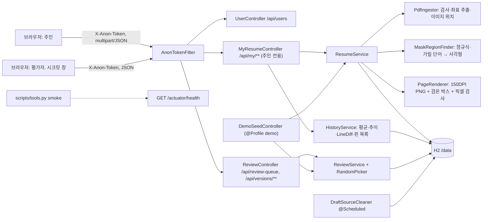
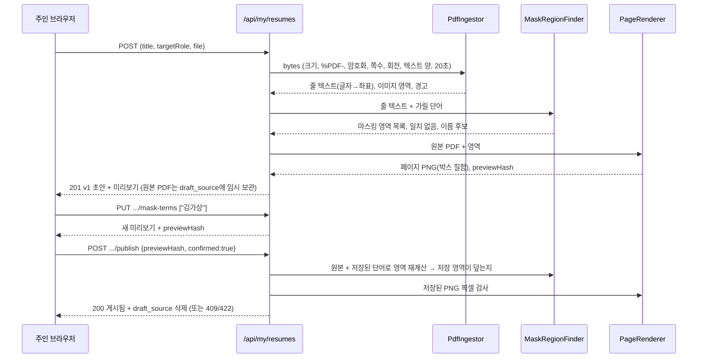
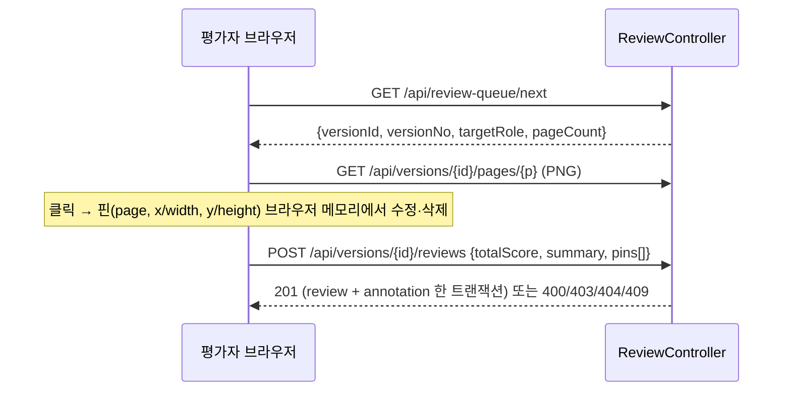

# 설계: 익명 이력서 평가와 버전별 평가 이력

> 2026-11-25: 저장소(H2 파일 DB·`ddl-auto=update`), 인증 필터(`AnonTokenFilter` 단독), 보안 헤더 필터, 컨테이너 구성은 `.kiro/specs/production-readiness/`가 대체했다(Flyway + PostgreSQL, Spring Security, 관리 포트, 멀티 스테이지 이미지). 이 문서는 MVP 당시 설계 기록으로 남긴다.

## 개요
Spring Boot 단일 앱이 JSON API와 정적 화면(HTML/CSS/바닐라 JS)을 함께 제공한다. 업로드된 PDF는 PDFBox로 글자 좌표(TextPosition)와 함께 텍스트를 추출하고, 정규식·가릴 단어·페이지 내 이미지 위치로 마스킹 영역을 계산한다. 그다음 `PDFRenderer`로 페이지를 150DPI PNG로 렌더링하고 그 이미지 위에 불투명 검은 박스를 칠한다. PDF 자체에는 아무것도 덮지 않는다. 평가자는 게시된 PNG만 받는다. 평가자는 이미지 위에 정규화 좌표로 핀과 코멘트를 남기고, 총평·총점과 함께 한 번에 제출한다. 주인은 버전별로 모든 핀을 겹쳐 보고, 평균 총점 추이(SVG)와 추출 텍스트 줄 단위 diff를 본다. 외부 API·AI 호출은 없으므로 타임아웃·샘플 응답 대상이 없다. 데모 데이터는 `demo` 프로필과 명시적 버튼으로만 들어간다.

- 런타임: Java 21, Spring Boot(버전은 앱 생성 때 확정, tech.md), Gradle Wrapper SHA-256 고정.
- 의존성 후보: `spring-boot-starter-web`, `-validation`, `-data-jpa`, `-actuator`, `com.h2database:h2`, `org.apache.pdfbox:pdfbox` 3.0.x(Apache-2.0). Boot 호환성 확인은 작업 1·2 담당.
- 저장소: H2 파일 DB `jdbc:h2:file:${DATA_DIR:./data}/resume-review`. 컨테이너는 `DATA_DIR=/data`(볼륨). 테스트는 H2 메모리. H2 콘솔은 끈다.
- 실행: `SERVER_ADDRESS=127.0.0.1`, `SERVER_PORT=18080`, `bootJar` 산출물 `app.jar`.
- 컨테이너: `fonts-noto-cjk` 설치. PDF에 글꼴이 포함되지 않은 한글도 렌더링되게 하기 위해서다.

## 아키텍처

업로드 → 미리보기 → 게시:

평가 제출:

## 구성 요소와 인터페이스
화면: `/`(평가받기·평가하기 두 버튼, 익명 토큰은 목적 화면 진입 시 자동 발급), `/upload.html`(업로드·미리보기·가릴 단어·게시), `/review.html`(무작위 평가·핀·총평·총점), `/my.html`(내 이력서·버전 목록·핀 오버레이·SVG 추이. 평가자 필터·diff는 확장 작업으로 미구현). 인라인 스크립트 없이 `/js/*.js`, 외부 CDN 없음.

### API
| 구성 요소 | 책임 | 인터페이스 | 요구사항 |
|---|---|---|---|
| UserController | 닉네임 받고 토큰 발급(인증 불필요) | `POST /api/users` {nickname} → 201 {token, nickname} | 1.2, 1.4 |
| UserController | 내 닉네임 확인 | `GET /api/users/me` | 1.5 |
| MyResumeController | 이력서 + v1 초안, 미리보기 | `POST /api/my/resumes` multipart(title, targetRole, file) → 201 | 2.x, 3.x |
| MyResumeController | 내 이력서 목록 | `GET /api/my/resumes` | 9.1 |
| MyResumeController | 버전 목록, 평균 총점, 평가 수, 추이·증감 | `GET /api/my/resumes/{resumeId}` | 9.2~9.4 |
| MyResumeController | 새 버전 초안(초안 있으면 교체) | `POST /api/my/resumes/{resumeId}/versions` multipart(file) → 201 | 5.1~5.4 |
| MyResumeController | 버전 상세: 상태, 추출 텍스트, 가릴 단어, 미리보기 메타 | `GET /api/my/resumes/{resumeId}/versions/{no}` | 3.6, 3.7, 3.8 |
| MyResumeController | 주인용 페이지 PNG(초안·게시 모두) | `GET /api/my/resumes/{resumeId}/versions/{no}/pages/{p}` → `image/png`, `Cache-Control: no-store` | 3.6 |
| MyResumeController | 가릴 단어 교체 → 새 미리보기 | `PUT /api/my/resumes/{resumeId}/versions/{no}/mask-terms` {terms[]} | 3.3, 3.9, 4.8, 4.9 |
| MyResumeController | 게시 | `POST /api/my/resumes/{resumeId}/versions/{no}/publish` {previewHash, confirmed} | 4.1~4.6 |
| MyResumeController | 평가·핀 목록(최신순, 평가자 라벨) | `GET /api/my/resumes/{resumeId}/versions/{no}/reviews` | 9.5~9.8 |
| MyResumeController (미구현, 확장 작업 16) | v(no-1) ↔ v(no) 추출 텍스트 diff | `GET /api/my/resumes/{resumeId}/versions/{no}/diff` | 10.x |
| ReviewController | 무작위 평가 대상 | `GET /api/review-queue/next?skip={versionId}` | 6.x |
| ReviewController | 게시된 마스킹 PNG | `GET /api/versions/{versionId}/pages/{p}` → `image/png` | 6.2, 11.5 |
| ReviewController | 평가 제출(핀 + 총평 + 총점) | `POST /api/versions/{versionId}/reviews` → 201, 본문 없음(엔티티·식별자를 돌려주지 않는다. 교차 리뷰 반영 2026-11-14) | 7.5, 7.6, 8.x |
| DemoStatusController | 데모 활성 여부(항상 등록, 인증 불필요) | `GET /api/demo` → {enabled} | 12.2 |
| DemoSeedController | 샘플 데이터(`demo` 프로필에서만 빈 등록) | `POST /api/demo/seed` → 201 | 12.3~12.5 |
| Actuator | smoke | `GET /actuator/health` | 11.8 |
| (미구현, 확장 작업 12) RecoveryController | 복구 코드 사용 | `POST /api/users/recover` {code} → {token} | 14.x |

### 응답 DTO 분리
- `ReviewTargetView`(평가자용): `versionId`, `versionNo`, `targetRole`, `pageCount`. 추출 텍스트·제목·resumeId·닉네임·가릴 단어·영역·다른 평가 필드가 아예 없다(11.2).
- `OwnerVersionView`: `status`, `extractedText`, `maskTerms`, `preview{pageCount, counts{EMAIL,PHONE,URL,TERM,IMAGE}, unmatchedTerms[], nameCandidate, warnings[], previewHash}`.
- `OwnerReviewView`: `reviewerLabel`(정수, 버전 안 제출 순서), `totalScore`, `summary`, `createdAt`, `sample`, `pins[{seq, page, x, y, comment}]`. 평가자 id·닉네임·토큰은 없다(1.6, 11.3).
- 엔티티를 그대로 JSON으로 직렬화하지 않는다.

### 요청·응답 JSON 계약 (병렬 구현용, 2026-11-14 고정)
화면(작업 9·10)과 API(작업 5~8)는 이 형식을 그대로 쓴다. 모든 요청에 헤더 `X-Anon-Token`. 오류는 `{code, message, fields}`.
- `POST /api/my/resumes` multipart(`title`, `targetRole`, `file`) → 201 `{resumeId, versionNo, version: OwnerVersionView}`
- `POST /api/my/resumes/{resumeId}/versions` multipart(`file`) → 201 `{resumeId, versionNo, version: OwnerVersionView}`
- `GET /api/my/resumes/{resumeId}/versions/{no}` → 200 `OwnerVersionView` + `{versionNo, publishedAt}`
- `PUT .../mask-terms` `{terms: string[]}` → 200 `OwnerVersionView`
- `POST .../publish` `{previewHash, confirmed: true}` → 200 `{versionNo, status: "PUBLISHED", publishedAt}`
- `GET /api/my/resumes` → 200 `[{resumeId, title, targetRole, latestVersionNo, reviewCount}]`
- `GET /api/my/resumes/{resumeId}` → 200 `{resumeId, title, targetRole, versions: [{versionNo, status, publishedAt, pageCount, reviewCount, averageScore(null 가능)}]}` (추이·증감 필드는 확장 작업 16에서 추가)
- `GET .../versions/{no}/reviews` → 200 `[OwnerReviewView]`
- `GET /api/review-queue/next?skip={versionId}` → 200 `ReviewTargetView` 또는 204(후보 없음)
- `POST /api/versions/{versionId}/reviews` `{totalScore: 1~5, summary, pins: [{page, x, y, comment}]}` → 201 본문 없음
- 페이지 이미지: 주인 `GET /api/my/resumes/{resumeId}/versions/{no}/pages/{p}`, 평가자 `GET /api/versions/{versionId}/pages/{p}` (p는 1부터) → `image/png`. 화면은 fetch → blob URL로 표시.
- `status` 값: `DRAFT`, `PUBLISHED`. 날짜는 ISO-8601 UTC 문자열.

### PdfIngestor (요구사항 2)
검사 순서와 실패 코드:
1. 크기: `spring.servlet.multipart.max-file-size=5MB`, `max-request-size=6MB`. `MaxUploadSizeExceededException` → 413 `FILE_TOO_LARGE`.
2. 첫 5바이트 `%PDF-` → 아니면 400 `NOT_PDF`.
3. `Loader.loadPDF(byte[])`. `InvalidPasswordException` 또는 `isEncrypted()` → 422 `ENCRYPTED_PDF`. 그 밖의 `IOException` → 422 `PDF_PARSE_FAILED`.
4. 쪽수 > 10 → 422 `TOO_MANY_PAGES`. 페이지 `getRotation() != 0` → 422 `UNSUPPORTED_PAGE_ROTATION`.
5. `PDFTextStripper` 하위 클래스(`setSortByPosition(true)`)의 `writeString(String, List<TextPosition>)`에서 줄마다 `LineText{page, text, charBoxes[]}`를 만든다. 글자 상자 = `(xDirAdj, yDirAdj - heightDir×1.2, widthDirAdj, heightDir×1.4)` (PDF 포인트, 왼쪽 위 원점). 스트리퍼가 넣은 단어 사이 공백은 상자 `null`.
6. `getUnicode()`가 null이거나 U+FFFD·사설 영역 문자를 포함하면 페이지별 경고(2.13).
7. 공백 제외 100자 미만 → 422 `NO_TEXT_LAYER`.
8. 이미지 위치: `PDFGraphicsStreamEngine` 하위 클래스의 `drawImage`에서 현재 CTM으로 단위 정사각형 네 꼭짓점을 변환해 외접 사각형을 구하고 y를 뒤집는다(`pageHeight - maxY`). 인라인 이미지와 Form XObject 안의 이미지도 같은 경로로 잡힌다. 이미지 `width×height > 25,000,000` → 422 `PDF_TOO_COMPLEX`.
- 추출과 렌더링 전체를 단일 스레드 `ExecutorService`에서 실행하고 `future.get(20, SECONDS)` 초과 시 `cancel(true)` 후 422 `PDF_TOO_COMPLEX`(2.9).
- 모든 검사는 엔티티 저장 전에 끝나므로 실패하면 아무것도 저장하지 않는다(2.11, 5.4).

### MaskRegionFinder (요구사항 3)
순수 함수 `find(lines, imageBoxes, terms) → MaskPlan{regions[], counts, unmatchedTerms, nameCandidate}`.
1. 가릴 단어: 긴 단어부터. 글자마다 `Pattern.quote` 후 `\s*`로 이어 `CASE_INSENSITIVE | UNICODE_CASE`.
2. 이메일 → URL(`https?://`, `www.`, `도메인.(com|net|org|io|dev|me|kr|co.kr)/경로`) → 전화(`01[016789]`, 지역번호 `0\d{1,2}`, `+82`, 구분자 `-`·`.`·공백) 순서로 줄 텍스트에 적용.
3. 일치 구간의 `null`이 아닌 글자 상자를 합친 사각형 1개 = 영역 1개(한 줄 안). 상하좌우 1pt 여유.
4. 이미지 상자는 유형 `IMAGE`로 그대로 영역에 넣는다.
5. `nameCandidate`: 첫 비어 있지 않은 줄의 글자 상자 중 영역에 덮이지 않은 것이 있으면 그 줄(최대 30자).
- 지원 직무 검사(2.12)는 2단계 정규식만 재사용한다.

### PageRenderer (요구사항 3.4, 3.5, 4.4)
- `PDFRenderer.renderImageWithDPI(page, 150, ImageType.RGB)`, `setAnnotationsFilter(a -> false)`로 주석·양식 모양을 그리지 않는다.
- 영역(pt)을 픽셀로 바꿀 때 `scale = 150/72`, 왼쪽·위는 `floor`, 오른쪽·아래는 `ceil`, 이미지 경계로 자른다. `Graphics2D`로 `Color(0,0,0)` 채우기, 안티앨리어싱 끔.
- PNG는 `ImageIO`로 인코딩해 `page_image`에 저장. `previewHash = SHA-256(page1 PNG ‖ page2 PNG ‖ ...)` hex.
- `verifyBlack(png, pixelRects)`: 각 영역 모든 픽셀의 RGB가 `0x000000`인지 검사. 게시 검증과 테스트가 같은 함수를 쓴다.

### 게시 (요구사항 4)
순서: `confirmed != true` → 400 → 상태 PUBLISHED면 409 `ALREADY_PUBLISHED` → `draft_source` 없으면 410 `DRAFT_SOURCE_EXPIRED` → 해시 비교(409 `PREVIEW_OUTDATED`) → 원본 + 저장된 단어로 `find()` 재실행, 재계산 영역이 모두 저장된 영역 안에 있는지 → 저장된 PNG에 `verifyBlack` → 실패 시 422 `MASKING_INCOMPLETE` + `failures[{page, type}]` → 성공 시 `status=PUBLISHED`, `published_at`, `draft_source` 삭제를 한 트랜잭션에서 실행. 클라이언트가 보낸 이미지는 받지 않는다.

### 원본 PDF 임시 보관 결정
- 결정: 초안 동안만 `draft_source` 테이블에 원본 바이트를 두고, 게시 트랜잭션에서 지우고, `DraftSourceCleaner`(`@Scheduled`, 10분 간격)가 업로드 후 24시간 지난 것을 지운다.
- 근거: 가릴 단어를 추가해 미리보기를 다시 만들려면 원래 페이지를 다시 렌더링해야 하고, 게시 검증(4.4)도 원본으로 영역을 재계산해야 한다. 가리지 않은 페이지 PNG를 대신 보관하면 그것도 신상이 그대로 담긴 데이터라 위험이 같고, 매번 다시 올리게 하면 미리보기 반복이 불편하다.
- 평가자·주인 어느 경로로도 응답하지 않는다(11.4).

### RandomPicker와 후보 조회 (요구사항 6)
- JPQL: `status = PUBLISHED AND resume.owner <> :me AND NOT EXISTS (review r where r.version = v and r.reviewer = :me)`. id 목록만 읽는다.
- `skip`이 있고 후보가 2개 이상이면 그 id를 뺀다.
- `RandomPicker` 인터페이스: 운영 구현 `ThreadLocalRandom` 균등 선택, 테스트 구현 고정 인덱스.

### ReviewService (요구사항 7, 8)
- 요청 DTO: `totalScore` `@NotNull @Min(1) @Max(5)` Integer, `summary` trim 후 20~1000자, `pins` `@Size(max=50)`, 핀 `page` `@NotNull`, `x`·`y` `@NotNull @DecimalMin("0") @DecimalMax("1")` Double(NaN·Infinity는 커스텀 검사로 거부), `comment` trim 후 1~500자. 페이지 상한(≤ pageCount)은 버전을 읽은 뒤 서비스에서 검사.
- 순서: 버전 조회(없거나 초안 404) → 주인이면 403 `SELF_REVIEW` → 페이지 범위 검사 → `review`와 `annotation`을 `@Transactional` 한 번에 저장. 유일 제약 `(version_id, reviewer_id)` 위반 → 409 `DUPLICATE_REVIEW`. 예외 시 전체 롤백(8.4).
- 핀 편집(7.4)은 브라우저 상태로만 다룬다. 서버에는 임시 저장 API가 없다.

### HistoryService (요구사항 9, 10)
- 버전별 `COUNT`, `AVG(total_score)`. `BigDecimal` 소수 둘째 자리 `HALF_UP`. 평가 0개면 `null`.
- 추이: 게시 버전 번호순, 이웃 두 버전 모두 평균이 있을 때만 `delta`.
- 평가자 라벨: 버전 안 `created_at` 오름차순 1, 2, ...; 응답 목록은 최신순.
- LineDiff: 추출 텍스트를 `\n`으로 나눠 LCS(DP)로 `EQUAL/ADDED/REMOVED`와 추가·삭제 수. 10쪽 제한으로 줄 수가 작아 새 의존성 없이 직접 구현.

### 화면 구현 메모
- 핀 오버레이: 페이지마다 `position: relative` 래퍼 안에 ``와 절대 위치 핀(`left: x*100%`, `top: y*100%`)을 둔다. 퍼센트 배치라 창 크기가 바뀌어도 같은 지점에 놓인다(7.3). 클릭 좌표는 `(clientX - rect.left) / rect.width`.
- 평가자별 색: 고정 팔레트 8색을 라벨 순으로 돌려 쓴다. 필터는 `<select>`(전체, 평가자 1, ...).
- SVG 차트: `<svg>`에 버전별 점과 꺾은선, y축 1~5 눈금을 `createElementNS`로 그린다. 컷 기준(실행 계획 05:30 UTC)에 걸리면 표로 대체.
- 사용자 입력은 `textContent`로만 넣는다(`innerHTML` 금지).

### 데모 샘플 데이터 (요구사항 12)
- `DemoSeedController`·`DemoSeeder`는 `@Profile("demo")`. 꺼지면 매핑이 없어 404 `{code:"NOT_FOUND"}`. `GET /api/demo`는 항상 있어 화면이 버튼을 숨긴다.
- `src/main/resources/demo/`: 샘플 사용자 3명의 이력서(백엔드·프론트엔드·데이터), 요청자용 v1(빽빽한 단일 열, 성과 수치 없음)·v2(2단 레이아웃, 여백·제목 위계 개선, 수치화된 성과). 모두 가상 인물·회사·이메일·전화와 가상 사진. 생성 스크립트 또는 PDFBox 코드로 만들고 Noto CJK 글꼴을 포함해 렌더링 차이를 없앤다.
- 시드는 실제 `ResumeService`(추출 → 마스킹 → 게시)와 `ReviewService`를 거친다. 샘플 평가: 요청자 v1만 시드(평균 약 2.7), v2는 시연에서 직접 올려 평가받는다. 평가마다 핀 2~4개(예: "경력 요약이 너무 깁니다", "성과에 수치가 있어 좋습니다").
- `sample = true` 표시. 요청자에게 샘플 이력서가 이미 있으면 409 `DEMO_ALREADY_SEEDED`. 샘플 사용자 3명은 앱 전체에서 한 번만 만든다.
- 시연: 주인 창에서 시드 → 시크릿 창(다른 익명 토큰)으로 실제 평가 1건 → 주인 창에서 핀이 늘어난 것을 확인.

## 익명 토큰과 접근 경계
- 발급(1.2): `SecureRandom` 32바이트 → Base64url 토큰. DB에는 `SHA-256(token)` hex만. 원래 토큰은 발급 응답에 한 번만 나간다.
- 전송: `localStorage` + `X-Anon-Token` 헤더. 쿠키를 쓰지 않아 CSRF 처리가 필요 없다. `` 요청에는 헤더를 붙일 수 없으므로 화면은 `fetch`로 PNG를 받아 `URL.createObjectURL`로 표시한다.
- `AnonTokenFilter`: `/api/**` 중 `POST /api/users`, `GET /api/demo`(선택 시 `POST /api/users/recover`)를 뺀 모든 요청에서 헤더 해시로 사용자를 찾는다. 없으면 401.
- 주인 경계(11.1): `/api/my/**`는 모두 `findByIdAndOwnerId(resumeId, me)`로 시작. 없으면 404. id는 UUID.
- 평가자 경계(11.2, 11.5): `/api/review-queue`, `/api/versions/**`는 `ReviewTargetView`와 게시된 PNG만 반환. 초안은 없는 것으로 취급. 게시된 PNG는 토큰이 있는 누구나 받을 수 있다(평가자에게 공개하려고 만든 이미지이므로 허용).
- 사용자 식별자(11.3): 응답 DTO에 `userId`, `tokenHash`, `reviewerId` 필드를 두지 않는다.
- 로그(11.6): 요청 본문·업로드 내용·`X-Anon-Token`을 로그에 남기지 않는다. 오류 로그에는 코드와 id만.
- 응답 헤더: `Content-Security-Policy: default-src 'self'; img-src 'self' blob:; script-src 'self'; style-src 'self'; object-src 'none'; frame-ancestors 'none'`, `X-Content-Type-Options: nosniff`.
- 네트워크(11.8): `server.address=${SERVER_ADDRESS:127.0.0.1}`, `management.endpoints.web.exposure.include=health`.
- 알려진 한계: ToUnicode 정보가 없는 글꼴은 글자를 읽지 못해 자동 마스킹이 빠질 수 있다(2.13 경고, 미리보기 필수, 2순위 13 수동 박스). 한 사람이 다른 브라우저로 새 토큰을 만들면 자기 이력서를 평가할 수 있다(범위 밖).

## 데이터 모델
`anon_user`
| 필드 | 타입 | 제약 |
|---|---|---|
| id | UUID | PK |
| nickname | varchar(20) | not null, trim 후 2~20자 |
| token_hash | char(64) | not null, unique |
| recovery_hash | char(64) | null, 선택 작업(요구사항 14) |
| sample | boolean | not null, 기본 false |
| created_at | timestamp | not null |

`resume`
| 필드 | 타입 | 제약 |
|---|---|---|
| id | UUID | PK |
| owner_id | UUID | FK anon_user, not null, 인덱스 |
| title | varchar(60) | not null, 주인만 봄 |
| target_role | varchar(40) | not null, 평가자도 봄, 연락처 패턴 금지 |
| sample | boolean | not null, 기본 false |
| created_at | timestamp | not null |

`resume_version`
| 필드 | 타입 | 제약 |
|---|---|---|
| id | UUID | PK, 평가자에게 노출되는 유일한 식별자 |
| resume_id | UUID | FK resume, not null |
| version_no | int | not null, ≥ 1, unique(resume_id, version_no) |
| status | varchar(10) | `DRAFT`/`PUBLISHED`, 이력서당 DRAFT 최대 1개(서비스 보장) |
| extracted_text | clob | not null, 주인 전용 |
| page_count | int | not null, 1~10 |
| preview_hash | char(64) | not null, 최신 미리보기 해시 |
| warnings | varchar(1000) | null, 2.13 경고 페이지 목록 |
| created_at | timestamp | not null |
| published_at | timestamp | null(초안) |

`draft_source` (초안 임시 원본)
| 필드 | 타입 | 제약 |
|---|---|---|
| version_id | UUID | PK, FK resume_version |
| pdf | blob | not null, ≤ 5MB, 응답 금지 |
| expires_at | timestamp | not null, 업로드 + 24시간 |

`mask_term`
| 필드 | 타입 | 제약 |
|---|---|---|
| version_id | UUID | FK resume_version |
| term | varchar(30) | 2~30자, 버전당 최대 50개, 주인 전용 |

`mask_region`
| 필드 | 타입 | 제약 |
|---|---|---|
| id | bigint | PK |
| version_id | UUID | FK resume_version, 인덱스 |
| page_no | int | 1~page_count |
| type | varchar(10) | `EMAIL`/`PHONE`/`URL`/`TERM`/`IMAGE`/`MANUAL`(2순위) |
| x, y, w, h | double | PDF 포인트, 왼쪽 위 원점, w·h > 0, 주인 전용 |

`page_image`
| 필드 | 타입 | 제약 |
|---|---|---|
| version_id | UUID | FK resume_version |
| page_no | int | 1~page_count, PK(version_id, page_no) |
| png | blob | not null, 마스킹 완료 이미지, 게시 후 불변 |
| width_px, height_px | int | not null |

`review`
| 필드 | 타입 | 제약 |
|---|---|---|
| id | UUID | PK |
| version_id | UUID | FK resume_version, not null |
| reviewer_id | UUID | FK anon_user, not null, 응답 금지 |
| total_score | smallint | not null, 1~5 |
| summary | varchar(1000) | not null, trim 후 20자 이상 |
| sample | boolean | not null, 기본 false |
| created_at | timestamp | not null |
| | | unique(version_id, reviewer_id) |

`annotation` (첨삭 핀)
| 필드 | 타입 | 제약 |
|---|---|---|
| id | bigint | PK |
| review_id | UUID | FK review, not null, 인덱스, review와 함께 저장(원자적) |
| seq | int | not null, 평가 안 1부터, unique(review_id, seq) |
| page_no | int | not null, 1~해당 버전 page_count |
| x | double | not null, 0 ≤ x ≤ 1 (CHECK), 이미지 너비 대비 |
| y | double | not null, 0 ≤ y ≤ 1 (CHECK), 이미지 높이 대비 |
| comment | varchar(500) | not null, trim 후 1~500자 |
| | | 평가당 최대 50개(서비스 검사) |

## 오류 처리
모든 오류 응답은 `{"code": "...", "message": "...", "fields": {...}}`이고 `code`는 바뀌지 않는다. `fields`는 검증 오류에만(핀은 `pins[3].x` 형식), `failures[]`는 `MASKING_INCOMPLETE`에만 넣는다. 전역 `@RestControllerAdvice`가 변환한다.

| 상황 | 응답 | 요구사항 |
|---|---|---|
| 닉네임·제목·지원 직무·가릴 단어·확인값 검증 실패 | 400 `VALIDATION_FAILED` + fields | 1.4, 2.12, 3.9, 4.3 |
| 핀 페이지·좌표 범위, 핀 코멘트, 핀 수, 총점, 총평 검증 실패 | 400 `VALIDATION_FAILED` + fields, 아무것도 저장 안 함 | 7.5, 7.6, 8.2~8.4 |
| 토큰 없음·모르는 토큰 | 401 `UNAUTHENTICATED` | 1.5 |
| PDF 아님 | 400 `NOT_PDF` | 2.3 |
| 5MB 초과 | 413 `FILE_TOO_LARGE` | 2.4 |
| 10쪽 초과 | 422 `TOO_MANY_PAGES` | 2.5 |
| 암호화 PDF | 422 `ENCRYPTED_PDF` | 2.6 |
| 텍스트 레이어 없음 | 422 `NO_TEXT_LAYER` | 2.7 |
| 해석 실패 | 422 `PDF_PARSE_FAILED` | 2.8 |
| 20초 초과·거대 이미지 | 422 `PDF_TOO_COMPLEX` | 2.9 |
| 회전 페이지 | 422 `UNSUPPORTED_PAGE_ROTATION` | 2.10 |
| 게시 해시 없음·불일치 | 409 `PREVIEW_OUTDATED` | 4.2 |
| 영역 재계산·픽셀 검사 실패 | 422 `MASKING_INCOMPLETE` + failures | 4.5 |
| 초안 원본 만료 | 410 `DRAFT_SOURCE_EXPIRED` | 4.8 |
| 게시된 버전에 게시·단어 변경 | 409 `ALREADY_PUBLISHED` | 4.9 |
| 후보 없음 | 204 본문 없음(정상 상태, 2026-11-14 요구사항 6.6 정정) | 6.6 |
| 같은 버전 중복 평가(동시 포함) | 409 `DUPLICATE_REVIEW` | 8.5 |
| 자기 이력서 평가 | 403 `SELF_REVIEW` | 8.7 |
| 없는·초안 버전 평가, 남의 이력서 접근, 초안 PNG 평가자 요청, 데모 꺼짐 | 404 `NOT_FOUND` | 8.8, 11.1, 11.5, 12.2 |
| v1 diff | 409 `NO_PREVIOUS_VERSION` | 10.4 |
| 샘플 중복 요청 | 409 `DEMO_ALREADY_SEEDED` | 12.5 |
| 예상하지 못한 예외 | 500 `INTERNAL_ERROR`, 스택·본문은 응답·로그에 없음 | 11.6 |

## 설계 결정과 근거
| 결정 | 근거 | 대안 | 상태 |
|---|---|---|---|
| 렌더링한 PNG에 박스를 칠함 | PDF에 박스를 덮으면 텍스트 레이어가 남아 복사·추출로 새어 나간다 | PDF 위 덮기, 마스킹 텍스트만 공개 | 확정(사용자) |
| 초안 동안만 원본 PDF 임시 보관, 게시 시 삭제 | 미리보기 재생성과 게시 검증에 원본이 필요. 위 "원본 PDF 임시 보관 결정" | 매번 재업로드, 가리지 않은 PNG 보관 | 기본값 |
| 페이지 내 모든 이미지를 가림 | 증명사진·회사 로고를 확실히 가리는 가장 단순한 규칙 | 이미지별 해제, 가림 정도 경고 | 2026-11-14 확정: MVP는 구분 없이 전부 가림, 이미지별 해제는 2순위 후보 |
| 핀 좌표를 0~1 정규화로 저장 | 화면 폭·DPI와 무관하게 같은 지점 | 픽셀 좌표 | 확정(사용자) |
| 제출 전 핀은 브라우저에만 | 원자적 제출 하나로 끝나 서버 상태·API가 줄어든다 | 서버 임시 저장 | 기본값 |
| 핀 버전 간 이월 없음 | 레이아웃이 달라 위치 의미가 없다 | 좌표 그대로 표시 | 확정(사용자) |
| 토큰을 헤더 + localStorage | CSRF 불필요, 구현 단순. 이미지는 fetch→blob | HttpOnly 쿠키 + CSRF | 기본값 |
| 남의 이력서 접근은 404 | 존재 여부 숨김 | 403 | 기본값 |
| 평가자 라벨은 버전별 번호 | 양방향 익명 | 이력서 전체 일관 라벨 | 2026-11-14 확정: 버전별 번호 유지 |
| SVG 차트·diff 직접 구현 | 외부 CDN·새 의존성 없음, 입력이 작다 | Chart.js, java-diff-utils | 기본값 |
| 복구 코드 | 토큰 분실 시 이력 접근 불가 문제 | 복구 코드 1회 표시 + 이어 쓰기(요구사항 14) | 2026-11-14 MVP 확정, 작업 12 |

## 테스트 전략
- 단위 테스트
  - `MaskRegionFinder`: 표 기반 사례(하이픈·점·공백 전화, `+82`, www·도메인 URL, 이메일, 글자 사이 공백 이름, 대소문자, 겹침, 일치 없음, 이름 후보, 이미지 상자 포함).
  - `LineDiff`(추가·삭제·동일·빈 텍스트), 평균 반올림과 평가 0개, 추이 증감 생략.
- 마스킹 픽셀 검사(완료 조건)
  - 테스트 코드에서 PDFBox로 가상 이름·이메일·전화·URL·이미지가 든 PDF를 만들고 업로드 → 가릴 단어 지정 → 게시.
  - 게시 PNG를 디코드해 `mask_region`을 픽셀로 바꾼 모든 사각형의 픽셀이 `0x000000`인지 검사한다.
  - 같은 PDF에서 이름 줄의 글자 상자를 직접 계산해 그 픽셀 영역이 저장된 영역 안에 들어 있는지 교차 확인한다(영역 계산 오류를 렌더러 자체 검사와 별도로 잡기 위해).
  - 주석이 있는 PDF를 렌더링해 주석 위치가 배경색인지 확인(3.5).
- 평가자 API 비노출(완료 조건)
  - 고유 문자열(가상 이메일, 이름, 가릴 단어, 제목)이 든 PDF를 게시한 뒤 평가자 토큰으로 `/api/review-queue/next`, `/api/versions/{id}/pages/*`, 평가 제출 응답을 모두 호출한다.
  - JSON 응답 본문에 고유 문자열, `%PDF-`, 다른 사용자의 토큰·토큰 해시·사용자 id가 없는지 확인하고, 모든 응답의 Content-Type이 `application/pdf`가 아닌지 확인한다.
  - 평가자 A가 제출한 핀 코멘트가 평가자 B의 어떤 응답에도 없는지 확인한다(11.2).
  - 주인 평가 목록 응답에 평가자 토큰·id·닉네임이 없고 `reviewerLabel`만 있는지 확인한다(11.3).
  - 다른 사용자 토큰으로 `/api/my/**` 전부를 호출해 404를, 초안 버전 PNG를 평가자 경로로 요청해 404를 확인한다(11.1, 11.5).
- 정규화 좌표 검증
  - 경계값 통과: `x=0, y=0`, `x=1, y=1`, `page=1`, `page=pageCount`, 핀 0개, 핀 50개, 코멘트 1자·500자.
  - 거부: `x=-0.0001`, `x=1.0001`, `y` 누락, `x="NaN"`·`Infinity`, `page=0`, `page=pageCount+1`, 핀 51개, 빈 코멘트, 501자.
  - 거부된 요청 뒤 `review`·`annotation` 행 수가 0인지 확인(8.4). 저장된 좌표를 다시 읽었을 때 보낸 값과 같은지 확인.
- 실패 경로 HTTP 테스트: `@SpringBootTest` + MockMvc, H2 메모리. PDF 아님, 5MB 초과, 11쪽, 암호화(`StandardProtectionPolicy`), 텍스트 없음, 회전, 해시 없음·불일치, 원본 만료, 중복 평가(동시 2요청 중 1개만 201), 자기 평가, 후보 없음. 테스트 이름에 요구사항 번호(`req8_5_duplicateReviewRejected`). 무작위는 고정 `RandomPicker`.
- 이진 픽스처는 테스트 코드에서 생성하고 저장소에 넣지 않는다(데모 샘플 PDF는 예외).
- 브라우저 E2E(Playwright 1.65.0, `e2e/`): 컨텍스트 2개(주인, 평가자). 랜딩 '평가받기' → PDF 업로드 → 이름 가리기 → 게시 → 평가자 무작위 받기 → 이미지 클릭으로 핀 2개(1개 수정, 1개 삭제 후 다시 추가) → 총평·총점 제출 → 주인이 v2 업로드·게시 → 버전 이력에서 핀 오버레이·필터·추이·diff 확인. 창 폭을 바꿔 핀 위치 비율이 유지되는지 확인. 단계별 스크린샷.
- 독립 검증: test 역할이 requirements.md만 보고 인수 조건 테스트 보강, check 역할이 `./gradlew test bootJar`, review 역할(gpt-5.6-terra, 대안 codex)이 diff 교차 리뷰.
- 배포 확인: `fonts-noto-cjk` 컨테이너 기동 후 `python3 scripts/tools.py smoke --port 18080`, 데모 샘플 PNG에서 한글이 두부(□)로 나오지 않는지 눈으로 확인.
