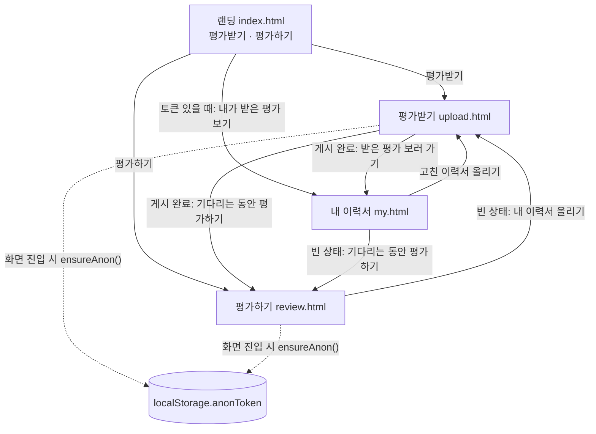
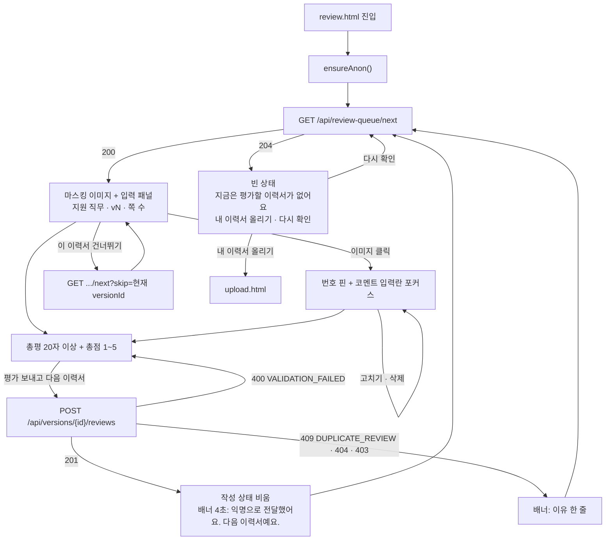
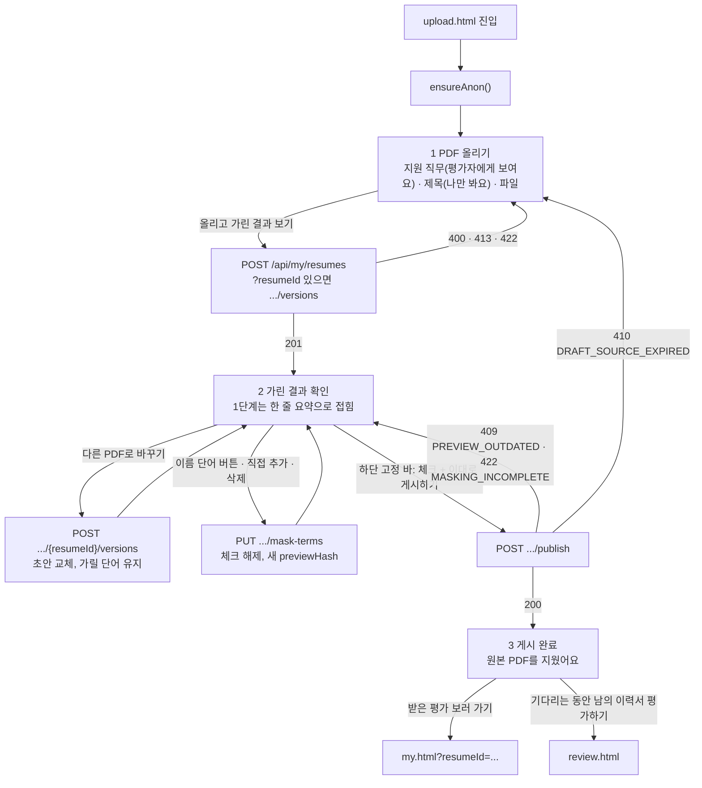

# UX 흐름: 평가하기 · 평가받기

- 대상 화면: `index.html`(랜딩), `review.html`(평가하기), `upload.html`(평가받기), `my.html`(내 이력서)
- 기준: requirements.md, design.md "요청·응답 JSON 계약", 현재 화면 코드(`static/*.html`, `js/*.js`)와 스크린샷(`artifacts/e2e/*.png`, 2026-11-14 04:16 UTC 캡처), 현재 E2E(`e2e/resume-flow.spec.cjs`, `e2e/demo.spec.cjs`)
- 제약: 정적 HTML/CSS/JS, 외부 CDN·인라인 `<script>`·`style=""` 속성 금지(CSP `script-src 'self'; style-src 'self'`). JS에서 `node.style.left = ...`처럼 CSSOM으로 넣는 값과 SVG 속성(`setAttribute('fill', ...)`)은 CSP에 걸리지 않으므로 핀 위치·차트에 쓴다.
- 화면 구현 예산 약 60분, 16:45 기능 동결. 새 큰 기능 없음. 백엔드 변경 없음(7절).
- 읽는 법: 3~6절은 **목표 화면**이다. 현재 화면(스크린샷)과 다른 점은 8.1 "P0 완료 확인" 표에 현재 → 목표로 모아 두었고, 구현자는 그 표의 확인 항목으로 끝났는지 판단한다.

## 1. 핵심 원칙

1. **첫 클릭이 곧 시작이다.** 회원가입도 닉네임 입력도 없다. `평가받기`나 `평가하기`를 누르면 바로 목적 화면이 열리고, 그 화면이 익명 토큰을 조용히 만든다.
2. **평가자가 볼 이미지 = 내가 확인한 이미지.** 가린 결과는 평가자가 받을 이미지 그대로 보여 주고, 게시 버튼 바로 옆에서 "원본 PDF는 게시하면 지운다, 게시 후에는 가림을 바꿀 수 없다"를 말한다.
3. **고칠 곳을 누르면 첨삭이 된다.** 평가자는 이미지를 누르고 한 줄 쓰면 끝이다. 필수 입력은 총평(20자 이상)과 총점(1~5)뿐이다.
4. **보내면 다음 장이 바로 뜬다.** 평가 제출 뒤에는 완료 카드를 거치지 않고 다음 이력서가 곧바로 열린다. 막다른 화면은 후보가 없을 때뿐이고, 거기에도 다음 행동 버튼 두 개를 둔다.
5. **결과는 열자마자 보인다.** 내 이력서 화면은 클릭 없이 최신 게시 버전을 열고, 맨 위에 버전별 평균 총점 추이와 직전 버전 대비 증감을 둔다.

## 2. 화면 흐름

### 2.1 전체

### 2.2 평가하기

### 2.3 평가받기

마지막 쪽을 끝까지 본 뒤에만 체크를 켜는 잠금은 P1이다(8절 T8). P0에서는 게시 바가 화면 아래에 항상 보이고, 체크 문구가 "모든 쪽을 확인했어요"를 요구한다.

## 3. 화면별 명세

### 3.0 공통

- 상단 내비: `이게 다 너 잘되라고 하는 소리야`(index.html 링크) · `평가받기` · `평가하기` · `내 이력서`. 닉네임 표시는 없앤다. 닉네임은 누구에게도 보이지 않는 값(1.6)이라 화면에 둘 이유가 없고, 화면에 이름처럼 보이는 값이 있으면 익명이라는 인상이 약해진다.
- 오류는 문제가 난 입력 바로 아래에 원인과 할 일을 한 문장씩 쓴다. 오류 코드값(`NOT_PDF` 등)은 보이지 않는다.
- 요청 중인 버튼은 비활성화하고 문구를 바꾼다(예: `올리는 중…`). 중복 클릭으로 요청이 두 번 가지 않는다.
- 배너(`.banner`, `role="status"`)는 화면 맨 위에 4초 동안 뜨고 사라진다. 새 배너가 뜨면 타이머를 다시 잰다.
- 하단 고정 바(`.sticky-bar`, `position: sticky; bottom: 0`)는 평가받기 게시와 모바일 평가 제출에 같은 모양으로 쓴다.
- 페이지 이미지는 세 화면 모두 `api.js`의 `loadPageImage(wrap, path, alt)` 하나로 받는다. 받는 동안 `wrap`에 회색 자리(`.page-wrap.loading`, `aspect-ratio: 1 / 1.414`)를 깔고, 실패하면 그 쪽 자리에 `이미지를 불러오지 못했어요.` + 버튼 `다시 불러오기`를 넣어 그 쪽만 다시 받는다. 성공하면 blob URL을 돌려줘 화면이 해제(`revokeObjectURL`)를 맡는다. 한 쪽이 실패해도 다른 쪽과 핀·평가 목록은 그대로 그린다(현재 my.js는 `Promise.all`이라 한 쪽 실패로 상세 전체가 비어 버린다).
- 본문 폭은 모든 화면 `main { max-width: 960px }` 하나로 맞춘다. 지금 my.html만 `.my-main { max-width: 1100px }`이라 내비(960px)와 왼쪽 선이 어긋난다(스크린샷 04).
- 모바일 기준 폭 600px 이하: 버튼은 전체 폭, 두 열 배치는 한 열로 접는다.

### 3.1 랜딩 `index.html`

| 항목 | 내용 |
|---|---|
| 목적 | 3초 안에 무엇을 하는 곳인지와 할 수 있는 두 가지를 알게 하고, 한 번 눌러 바로 시작하게 한다. |
| 첫눈에 보이는 것 | 작은 문제 문구 `이름 붙은 이력서를 지인 몇 명에게만 보내고, 피드백은 카톡에 흩어져 있나요?` → 제목 `이게 다 너 잘되라고 하는 소리야` → 한 줄 소개 `이름은 가리고 디자인은 그대로. 모르는 사람들의 첨삭을 버전별로 모아 보세요.` → 같은 크기의 큰 버튼 두 개 → 안심 문구 한 줄 |
| 버튼 | `평가받기`(아래 작은 글씨 `내 이력서 올리고 첨삭 받기`, `href="upload.html"`), `평가하기`(아래 작은 글씨 `남의 이력서에 첨삭 남기기`, `href="review.html"`). 두 버튼은 크기·굵기가 같고 나란히 둔다. JS 없이 동작하는 링크다. |
| 안심 문구 | `회원가입 없음 · 이름·연락처·사진은 검게 가린 이미지로만 공개 · 원본 PDF는 게시하면 바로 삭제` |
| 재방문 | `localStorage.anonToken`이 있으면 버튼 아래 텍스트 링크 `내가 받은 평가 보기 →`(my.html). 버튼 두 개 구성은 그대로다. |
| 데모 | `GET /api/demo`가 `enabled: true`일 때만 맨 아래 작은 보조 버튼 `데모용 샘플 데이터 넣기`(`#demo-btn`). 누르면 `ensureAnon()` → `POST /api/demo/seed` → my.html |
| 제거 | 닉네임 폼(`#start`), 메뉴 카드(`#menu`, `#welcome`), 토큰 분실 안내(`#notice`). 분실 안내는 게시 완료 화면으로 옮긴다(4절). |
| 상태 | 로딩: 없음(링크 이동). 데모 버튼 요청 중: `넣는 중…`. 데모 409: `이미 샘플 데이터를 넣었어요.` + `내 이력서 보기` 링크. 데모 기타 오류: `연결에 실패했어요. 잠시 후 다시 눌러 주세요.` |
| 모바일 | 버튼 두 개를 세로로 쌓고(평가받기 위), 각 버튼 높이 64px 이상 |

### 3.2 평가하기 `review.html`

| 항목 | 내용 |
|---|---|
| 목적 | 고르지 않고 받은 이력서 한 장에 위치별 첨삭을 남기고, 보내면 바로 다음 장으로 넘어간다. |
| 첫눈에 보이는 것 | 위 줄 `지원 직무: 백엔드 개발자 · v2 · 1쪽`, 오른쪽 `이 이력서 건너뛰기`(`#other-btn`). 그 아래 안내 한 줄 `고칠 곳을 누르면 핀이 꽂혀요. 핀 없이 총평만 남겨도 돼요.` 이어서 마스킹 이미지 |
| 구조(P0 HTML) | `#done-area`(배너, 맨 위) → `#status` → `#empty-area` → `#review-area` 안에 `.review-grid` > `.review-image`(`#pages`) + `.review-panel`(내 핀, 총평, 총점, 제출). P0는 한 열로 보이고, P1에서 CSS만 더해 두 열로 바꾼다. |
| 배치(P1, 900px 이상) | `.review-grid { display: grid; grid-template-columns: 3fr 2fr; }`, `.review-panel { position: sticky; top: 12px; max-height: calc(100vh - 24px); overflow: auto; }`. 이미지를 내려도 패널이 따라와 핀을 꽂고 바로 쓴다. |
| 핀 | 클릭 위치에 번호 핀 → 패널의 해당 입력란 포커스. placeholder `이 위치에 대한 코멘트 (예: 성과에 숫자를 넣어 보세요)`. 각 핀에 `삭제` 버튼(현재 문구 유지, E2E가 이 이름으로 찾는다). 이미지의 핀을 누르면 그 입력란으로 이동. 제목 `내 핀 (2 / 50)` |
| 총평 | 라벨 `총평 (20자 이상)`, placeholder `가장 먼저 고칠 점과 좋은 점을 한두 문장으로 남겨 주세요.`, 카운터 `12 / 20자 이상`. 앞뒤 공백을 뺀 길이로 세고, 20 미만이면 주황(`.short`), 20 이상이면 `24자 · 좋아요`로 바꾸고 초록. 1000자 상한은 `maxlength`로 막는다. |
| 총점 | P0: 라디오 1~5 아래에 `1 많이 고쳐야 해요 · 5 바로 지원해도 돼요` 한 줄. P1: 라벨을 버튼 모양(높이 44px)으로 만들고 `label:has(input:checked)`로 선택 표시. `input`은 숨기지 않는다(E2E가 `input[name=score]`를 `check()`한다). |
| 제출 버튼 | `평가 보내고 다음 이력서`(`#submit-btn`). 총평 20자 미만·총점 없음·빈 핀 코멘트가 있으면 해당 칸 아래에 이유를 보여 주고 첫 문제 칸으로 스크롤 |
| 완료(201) | 핀·총평·총점을 비우고 즉시 `loadNext()`. 배너 `익명으로 전달했어요. 다음 이력서예요.`(4초). `sessionStorage.reviewedCount`를 1 올린다. 완료 카드와 `다음 이력서 평가하기` 버튼(`#next-btn`)은 없앤다. `resetView()`는 배너를 건드리지 않는다. |
| 로딩 | `평가할 이력서를 고르는 중…`. 이미지 자리에 회색 상자(`aspect-ratio: 1 / 1.414`)를 먼저 깔아 화면이 튀지 않게 한다. |
| 빈 상태(204) | `#empty-area`: 제목 `지금은 평가할 이력서가 없어요`. 이번 방문에 평가했으면 `이번에 3개를 평가했어요. 고마워요!` 한 줄. 본문 `새 이력서가 올라오면 다시 받을 수 있어요.` 버튼 `내 이력서 올리기`(upload.html), 보조 `다시 확인`(`#retry-btn`). 제출 직후 204면 배너는 `익명으로 전달했어요.`만 쓴다. |
| 오류 | 409 `DUPLICATE_REVIEW`·404 `NOT_FOUND`: 작성 내용을 버리고 다음 이력서로 넘어가며 배너 `이미 평가했거나 내려간 이력서라 다음 이력서로 넘어왔어요.` 403 `SELF_REVIEW`: 같은 방식, `내 이력서라 건너뛰었어요.` 400: 필드 오류를 해당 칸 아래에. 이미지 실패: 공통 `loadPageImage`의 `다시 불러오기`(그 쪽만 다시 받고 꽂아 둔 핀은 유지). 토큰 발급·대상 요청 네트워크 오류: `연결에 실패했어요.` + `다시 확인` |
| 건너뛰기 | 작성 중인 핀·총평이 있으면 `작성 중인 핀과 총평이 사라져요. 건너뛸까요?` 확인. 받은 대상의 `versionId`가 그대로면(후보 1개, 6.5) 배너 `다른 이력서가 없어 같은 이력서를 다시 보여 드려요.` |
| 모바일 | 한 열: 상단 정보 → 이미지(전체 폭) → 내 핀 → 총평·총점. 제출 버튼은 P1에서 `.sticky-bar`로 화면 아래 고정. 핀을 꽂으면 해당 입력란으로 스크롤한다(현재 동작). 이미지 바로 아래에 "방금 꽂은 핀" 입력란을 펼치는 방식은 P2 |

### 3.3 평가받기 `upload.html`

맨 위에 단계 표시 `#steps`(`1 PDF 올리기 → 2 가린 결과 확인 → 3 게시`)를 두고 현재 단계를 굵게 표시한다. 한 번에 한 단계 카드만 크게 보인다. 업로드가 끝나면 1단계 카드는 한 줄 요약으로 접혀, 게시까지 필요한 것만 남는다.

**1단계 PDF 올리기 `#upload-card`**

| 항목 | 내용 |
|---|---|
| 목적 | 가진 PDF를 고치지 않고 그대로 올린다. |
| 첫눈에 보이는 것 | 새 이력서: `지원 직무 (평가자에게 보여요)`, `제목 (나만 봐요)`, `PDF 파일`. `?resumeId=`로 들어온 새 버전: 제목·지원 직무 없이 `‘백엔드 개발자 이력서’의 새 버전을 올려요`와 파일 칸만. 조건 문구 `PDF · 5MB 이하 · 10쪽 이하 · 글자를 선택할 수 있는 파일` |
| 입력 | 지원 직무 placeholder `예: 백엔드 개발자`, `maxlength="40"`. 제목 placeholder `예: 2026 하반기 백엔드`, `maxlength="60"`(요구사항 2.1 한도에 맞춤, 현재 100). P1: 파일을 고르면 제목이 비어 있을 때 파일 이름에서 `.pdf`를 뺀 값을 채운다. |
| 버튼 | `올리고 가린 결과 보기`(`#upload-btn`) |
| 로딩 | 버튼 `가리는 중…`, 안내 `이메일·전화번호·링크·사진을 찾아 검게 칠하고 있어요. 최대 20초 걸려요.` |
| 접힌 요약 | 업로드 201 뒤 `#upload-card`에 `.collapsed`: `owner-v1.pdf · 백엔드 개발자 · v1 초안` + 텍스트 버튼 `다른 PDF로 바꾸기`. 바꿔 올리면 `state.resumeId`가 이미 있으므로 `POST /api/my/resumes/{resumeId}/versions`로 보내 초안을 교체한다(5.3, 가릴 단어 유지). 새 이력서를 하나 더 만들지 않는다. |
| 오류 | 파일 칸 아래에 기존 `upload.js` 문구(NOT_PDF, FILE_TOO_LARGE, TOO_MANY_PAGES, ENCRYPTED_PDF, NO_TEXT_LAYER, PDF_PARSE_FAILED, PDF_TOO_COMPLEX, UNSUPPORTED_PAGE_ROTATION)를 해요체로. 지원 직무 400(2.12): `지원 직무에는 이메일·전화번호·링크를 넣을 수 없어요. 평가자에게 그대로 보여요.` |
| 모바일 | 한 열, 파일 칸 전체 폭 |
| 기존 이력서 안내(P1) | `?resumeId` 없이 들어왔는데 `GET /api/my/resumes`가 1개 이상이면 1단계 카드 맨 위에 한 줄 `고친 이력서라면 ‘백엔드 개발자 이력서’의 새 버전으로 올려야 점수 변화를 비교할 수 있어요.` + 링크 `새 버전으로 올리기 →`(`upload.html?resumeId=..`, 최근 이력서 1개만). 새 이력서로 올리는 기본 동작은 그대로다. |

**2단계 가린 결과 확인 `#preview-card`**

| 항목 | 내용 |
|---|---|
| 목적 | 평가자에게 보일 이미지를 확인하고, 자동으로 못 가린 이름·회사·학교를 가린 뒤 게시한다. |
| 위 패널 | `자동으로 가린 곳` 칩 `이메일 1 · 전화번호 1 · 링크 1 · 사진 1 · 지정 단어 1`(0인 항목은 흐리게). 경고(2.13)는 노란 상자 `2쪽: 일부 글자를 읽지 못해 자동으로 못 가린 곳이 있을 수 있어요. 이미지를 꼼꼼히 확인하세요.` |
| 이름 가리기 | 제목 `이름 가리기`, 설명 `이름은 자동으로 찾지 않아요. 첫 줄에서 찾은 단어 중 이름을 누르면 가려져요.` `nameCandidate`를 공백으로 나눠 2자 이상인 단어마다 버튼 `+ 김하늘`(`#name-candidate button`). 가릴 단어가 하나도 없을 때만 보이고, 하나라도 생기면 숨긴다. 이미 가릴 단어에 있는 단어는 버튼을 만들지 않는다. |
| 가릴 단어 | 입력 placeholder `이름, 회사, 학교 등 (2~30자)`, 버튼 `가리기`(`#term-btn`). 칩 `김하늘 삭제`. 찾지 못한 단어는 노란 칩에 `<small>찾지 못함</small>`을 덧붙이고 아래에 `오타가 없는지 확인하세요.` 칩 안 첫 `span`에는 단어만 넣는다(데모 스크립트가 `#terms .chip > span` 글자로 단어를 읽는다). |
| 미리보기 | 이미지 위 고정 라벨 `평가자는 이 이미지만 봐요. 원본 PDF와 글자 데이터는 보내지 않아요.` 쪽마다 `1 / 2쪽`. 마지막 쪽 아래에 빈 요소 `#pages-end`(P1 잠금에서 감시). 이미지 실패는 공통 `다시 불러오기`이고, 실패한 쪽이 하나라도 있으면 `#confirm`을 끈다(못 본 쪽을 확인했다고 체크할 수 없게) |
| 다시 가리는 중 | 단어를 바꾸면 `#term-msg`에 `다시 가리는 중…`, 체크 해제, 체크·게시 버튼 비활성. 새 previewHash를 받은 뒤 다시 켠다. 이미지 위 반투명 덮개는 P2 |
| 게시 바 `#publish-card` | `.sticky-bar`로 화면 아래에 항상 보인다. 내용: 체크박스 `#confirm` `평가자에게 보일 이미지를 모든 쪽 확인했어요` · 한 줄 `게시하면 원본 PDF를 바로 삭제하며 이후 가림을 바꿀 수 없어요.` · 버튼 `이대로 게시하기`(`#publish-btn`). 바 아래 작은 글씨 `게시하지 않으면 원본은 24시간 뒤 자동으로 지워져요.` |
| 마지막 쪽 잠금(P1) | `IntersectionObserver`로 `#pages-end`가 한 번이라도 화면에 들어오기 전에는 `#confirm` 비활성 + `마지막 쪽 끝까지 내려 보면 체크할 수 있어요.` 단어를 바꿔 이미지가 다시 그려지면 잠금도 다시 건다. |
| 오류 | 409 `PREVIEW_OUTDATED`: `가린 결과가 바뀌었어요. 최신 이미지를 다시 확인해 주세요.`(체크 해제). 422 `MASKING_INCOMPLETE`: `N쪽 가림 검증에 실패해 게시하지 않았어요. 가릴 단어를 다시 저장해 주세요.` 410 `DRAFT_SOURCE_EXPIRED`: `초안 원본 보관 시간(24시간)이 지나 지웠어요. 같은 PDF를 다시 올려 주세요.` + 1단계 펼침 |
| 이어서 게시(P1) | my.html 초안 행의 `이어서 게시`(`?resumeId=..&versionNo=..`)로 들어오면 `GET /api/my/resumes/{id}/versions/{no}`로 초안을 불러와 2단계를 바로 연다. 지금은 `versionNo`를 무시하고 빈 업로드 폼을 보여 준다. P0에서는 링크 문구를 `PDF 다시 올려 게시하기`로 바꿔 실제 동작과 맞춘다. |
| 배치(P2, 900px 이상) | 왼쪽 이미지, 오른쪽 sticky 패널(위 패널·이름·단어) |
| 모바일 | 한 열: 위 패널 → 이름 가리기 → 가릴 단어 → 이미지. 게시 바는 화면 아래 고정, 한 줄 문구는 두 줄로 줄바꿈 |

**3단계 게시 완료 `#done-card`**

| 항목 | 내용 |
|---|---|
| 목적 | 공개됐다는 사실과 원본이 지워졌다는 사실을 확인시키고 다음 행동으로 잇는다. |
| 전환 | 게시 200이면 `#preview-card`를 숨기고 `#done-card`를 보인다. 단계 표시는 3. |
| 첫눈에 보이는 것 | 제목 `v1을 게시했어요`, 본문 `이제 모르는 사람들이 무작위로 받아 평가해요.` 안심 상자 `원본 PDF는 방금 서버에서 지웠어요. 남은 것: 가린 페이지 이미지 · 나만 보는 글자 데이터 · 가린 위치 목록` |
| 버튼 | 주 `받은 평가 보러 가기`(`my.html?resumeId=..`), 보조 `기다리는 동안 남의 이력서 평가하기`(review.html) |
| 토큰 안내(1.3) | 작은 글씨 `이 브라우저가 내 이력서의 열쇠예요. 브라우저 데이터를 지우거나 다른 기기·시크릿 창에서는 이 이력서를 볼 수 없어요.` |
| 모바일 | 버튼 세로 쌓기 |

### 3.4 내 이력서 `my.html`

| 항목 | 내용 |
|---|---|
| 목적 | 버전별 점수 변화와 지적 위치를 클릭 없이 한 화면에서 본다. |
| 자동 열기 | `?resumeId=`가 있거나 이력서가 하나뿐이면 `openResume()` 후 가장 높은 번호의 게시 버전으로 `openVersion()`을 바로 부른다. 게시 버전이 없으면(초안만) 버전 목록까지만 연다. 이력서가 여럿이면 지금처럼 목록에서 고른다. 목록 행과 `열기` 버튼은 한 줄로 남겨 다른 이력서로 바꿀 수 있게 한다. |
| 첫눈에 보이는 것 | 제목 `내 이력서가 받은 평가` → `#trend-card`: 이력서 제목 + `지원 직무: 백엔드 개발자`, 큰 글씨 요약 `v1 2.67 → v2 5.00`, 증감 배지 `+2.33`(초록, 감소면 빨강, 0이면 회색 `±0.00`), 그 아래 SVG 꺾은선 → 버전 목록 → 상세(이미지 + 핀 + 평가) |
| 추이 계산 | 데이터는 `GET /api/my/resumes/{id}`의 `versions[]`(게시 버전, `versionNo` 순). 요약과 배지는 최신 게시 버전과 바로 앞 게시 버전을 비교하고, 둘 다 `averageScore`가 있을 때만 보인다(9.3, 9.4). 평균이 없는 버전은 `v2 평가 없음`으로 쓰고 배지를 생략한다. 최신 게시 버전이 `평가 없음`이면 요약 줄 오른쪽에 `기다리는 동안 평가하기` 버튼(review.html)을 둔다. 게시 직후 돌아온 주인이 빈 화면에서 멈추지 않게 하기 위해서다. 위 숫자는 예시이고, 녹화에서는 6절 조건 때문에 실제 값이 달라질 수 있다. |
| SVG | `createElementNS`로 `viewBox="0 0 320 140"`, 폭 100%(최대 480px). y축 1~5 눈금선 다섯 개, x축 게시 버전 라벨. 평균이 있는 버전만 점(`r=5`)과 값 라벨을 그리고, 이웃 두 버전 모두 평균이 있을 때만 선으로 잇는다. 게시 버전이 1개면 SVG 없이 `v1 평균 2.67점 · 평가 3개` + `고친 버전을 올리면 점수 변화가 여기 보여요.` + 버튼 `고친 이력서 올리기 (v2)` |
| 버전 목록 | 행마다 `v1` · `게시됨` · `평균 2.67점`(또는 `평가 없음`) · `평가 3개` · `평가 보기` 버튼. 현재 열린 버전은 강조. 초안은 `v3 · 초안` + `PDF 다시 올려 게시하기`(P1에서 `이어서 게시`). 문구 `평균 N.NN점`과 버튼 이름 `평가 보기`는 E2E가 찾으므로 유지 |
| 상세 | 현재 구조 유지: 제목 `v2 평가 결과 · 평균 5.00점 · 평가 1개`, 왼쪽 이미지 + 평가자별 색 핀(`2-3`), 오른쪽 핀 코멘트 목록·평가 목록(최신순, `샘플` 배지). 목록의 핀을 누르면 이미지의 핀 강조 |
| 버튼 | `고친 이력서 올리기 (v3)`(`#new-version-link`, `upload.html?resumeId=..`), 평가 없음 상태의 `기다리는 동안 평가하기` |
| 빈 상태 | 이력서 없음(토큰 없음 포함): `아직 올린 이력서가 없어요.` + 버튼 `평가받기` + 작은 글씨 `다른 브라우저에서 올렸다면 그 브라우저에서 열어 주세요.` 선택한 버전에 평가 없음: `아직 받은 평가가 없어요. 평가는 무작위로 배정되니 조금 기다려 주세요.` + `기다리는 동안 평가하기` |
| 오류 | 401·토큰 없음: index.html로 돌려보내지 않고 위 "이력서 없음" 빈 상태를 보인다. my.html은 토큰을 만들지 않는다(새 토큰에는 볼 이력서가 없다). 그 밖의 오류: `불러오지 못했어요.` + `다시 시도`. 페이지 이미지 실패는 공통 `다시 불러오기`(그 쪽만), 평가 목록은 이미지와 따로 받아 먼저 그린다 |
| 모바일 | 한 열: 추이 카드 → 버전 목록 → 이미지 → 핀 목록 → 평가 목록 |

## 4. 익명 토큰 발급

- 시점: 토큰이 필요한 화면에 처음 들어올 때 한 번. `review.html`·`upload.html`의 초기화, 랜딩의 `데모용 샘플 데이터 넣기` 클릭. 랜딩과 my.html을 보기만 해서는 만들지 않는다(빈 사용자 행이 쌓이지 않게).
- 방법: `api.js`에 `ensureAnon()`을 추가한다. `localStorage.anonToken`이 있으면 그대로 쓰고, 없으면 `POST /api/users {nickname: "익명" + 4자리 숫자}`(예: `익명4821`, 2~20자 규칙 충족, 숫자는 `crypto.getRandomValues`)를 보내 `saveIdentity()`로 저장한다. 진행 중인 요청 Promise를 모듈 변수에 두어 두 번 불려도 POST는 한 번만 나간다. 사용자는 아무것도 입력하지 않는다. `ensureUser(nickname)`은 삭제한다(호출하던 index.js의 닉네임 폼이 사라진다).
- 랜딩 버튼이 아닌 목적 화면에서 만드는 이유: 랜딩 버튼을 JS 없는 링크로 둘 수 있고, 내비·북마크·새 탭으로 바로 들어온 경우와 코드 경로가 하나가 된다. 사용자가 보는 마찰은 같다(클릭 한 번에 목적 화면).
- 마찰: 목적 화면의 첫 로딩 문구(`평가할 이력서를 고르는 중…`) 안에서 끝나 별도 화면이 없다. 실패하면 같은 자리에 `연결에 실패했어요.` + `다시 시도`.
- 401 처리: `api.js`가 401에서 토큰을 지우는 현재 동작은 유지한다. 평가하기는 `ensureAnon()`으로 새 토큰을 받아 대상 요청을 한 번 다시 보낸다(평가자에게는 잃을 데이터가 없다). 평가받기 2단계에서 401이 나면 초안이 옛 토큰 소유라 이어 갈 수 없으므로 `이 브라우저의 익명 열쇠가 사라져 초안을 이어 갈 수 없어요. PDF를 다시 올려 주세요.`를 보이고 1단계로 돌아간다. 내 이력서는 3.4의 빈 상태.
- 분실 안내(1.3): 3단계 게시 완료 화면에서 보여 준다. 지킬 데이터가 생긴 시점이고, 평가만 하는 사람에게는 필요 없다.
- 복구 코드(요구사항 14, tasks.md 작업 12)는 아직 구현 전이라 이번 1시간 범위에 넣지 않는다. 구현되면 게시 완료 화면의 토큰 안내 자리에 1회 표시한다. 랜딩에는 넣지 않는다.
- 시연: 시크릿 창은 저장소가 비어 있으므로 `평가하기` 한 번에 별도 평가자 토큰이 생긴다.

## 5. 신뢰·개인정보 안심 장치

| 장치 | 위치 | 근거 |
|---|---|---|
| 랜딩 안심 문구 `이름·연락처·사진은 검게 가린 이미지로만 공개 · 원본 PDF는 게시하면 바로 삭제` | 3.1 | 문제 1(신상 노출 거부감) |
| 라벨 `지원 직무 (평가자에게 보여요)` / `제목 (나만 봐요)` | 3.3 1단계 | 11.2, 2.12 |
| 자동으로 가린 곳 개수 칩, 0인 항목 흐리게 | 3.3 2단계 | 3.6 |
| 이미지 위 고정 라벨 `평가자는 이 이미지만 봐요. 원본 PDF와 글자 데이터는 보내지 않아요.` | 3.3 2단계 | 4.1, 11.2 |
| 이름은 사용자가 누르는 단어 버튼으로만 가림, 가릴 단어가 생기면 후보를 숨김, 찾지 못한 단어는 노란 칩 | 3.3 2단계 | 3.7, 3.8, 이름 자동 추정 안 함 결정 |
| 단어를 바꾸면 체크 해제, P1에서 마지막 쪽을 본 뒤에만 체크 가능 | 3.3 2단계 | 4.1~4.3 |
| 이미지가 한 쪽이라도 안 뜨면 체크 불가, 그 쪽만 `다시 불러오기` | 3.0, 3.3 2단계 | 4.1 |
| 게시 버튼 바로 옆 `게시하면 원본 PDF를 바로 삭제하며 이후 가림을 바꿀 수 없어요.` | 3.3 게시 바 | 4.6, 4.9 |
| 게시 바 아래 `게시하지 않으면 원본은 24시간 뒤 자동으로 지워져요.` | 3.3 게시 바 | 4.7 |
| 게시 완료 안심 상자 `원본 PDF는 방금 서버에서 지웠어요. 남은 것: …` | 3.3 3단계 | 4.6, 11.4 |
| 평가 배너 `익명으로 전달했어요.` | 3.2 완료 | 1.6 |
| 상단 내비에서 닉네임 제거, 주인 화면의 평가자는 `평가자 1, 2…`로만 표시 | 3.0, 3.4 | 1.6, 11.3 |

## 6. 3분 데모의 "와" 순간

데이터 전제(코드 확인): `POST /api/demo/seed`는 요청자 v1(샘플 평가 3건, 평균 2.67)과 샘플 사용자 3명의 게시 이력서만 만든다. v2는 시연에서 직접 올린다(`DemoSeeder` 주석). 그래서 녹화 시작 시점에는 추이를 보여 줄 v2가 없다. 첫 30초의 결과 화면은 녹화 마지막 장면(my.html 추이 카드)을 편집에서 앞에 붙인 콜드 오픈으로 만든다(`e2e/to-mp4.sh` 구간 편집, 화면 작업 아님).

| 시각 | 장면 | 화면 | 보여 줄 것 |
|---|---|---|---|
| 0:00~0:08 | 문제 | index.html | 문제 문구 `이름 붙은 이력서를 지인 몇 명에게만 보내고, 피드백은 카톡에 흩어져 있나요?`와 버튼 두 개 |
| 0:08~0:30 | 결과(콜드 오픈) | my.html, 녹화 끝 장면 | 열자마자 추이 카드 `v1 → v2`와 초록 증감 배지, 아래 v2 이미지 위 색색의 핀. 클릭 없이 뜬다 |
| 0:30~1:15 | **와 1: 디자인은 그대로, 신상만 검게** | upload.html | v2 PDF를 올리자 1단계가 한 줄로 접히고, 이메일·전화·사진이 레이아웃 그대로 검게 칠해진 페이지가 뜬다. 가릴 단어 칩(v1에서 이월, 5.2)과 `평가자는 이 이미지만 봐요`. 게시 바의 `게시하면 원본 PDF를 바로 삭제…` → 게시 → `원본 PDF는 방금 서버에서 지웠어요` |
| 1:15~2:15 | **와 2: 가입 없이 바로 첨삭, 보내면 다음 장** | 시크릿 창 index → review.html | `평가하기` 한 번에 입력 없이 이력서가 뜬다. 고칠 문장을 누르면 그 자리에 핀 `1`이 꽂힌다. 총평 카운터가 주황에서 초록으로 바뀐다. `평가 보내고 다음 이력서` → 배너와 함께 다음 이력서가 곧바로 뜬다 |
| 2:15~3:00 | **와 3: 내 이력서 위에 쌓인 첨삭** | 주인 창 my.html | 방금 남긴 핀이 v2 이미지의 같은 위치에 새 색으로 나타나고, 추이 카드 숫자가 바뀌어 있다. 핀 목록을 누르면 이미지의 핀이 강조된다 |

녹화 스크립트(`e2e/demo.spec.cjs`) 조정이 필요한 점:
- 지금 스크립트는 화면 밖에서 평가자가 v2 외 모든 대상을 미리 평가해 v2만 남긴다. 그러면 v2 제출 뒤 204 빈 상태가 떠서 "와 2"의 "다음 장"이 보이지 않는다. 샘플 이력서 하나를 남겨 두고, 첫 대상이 그 샘플이면 화면에서 `이 이력서 건너뛰기`를 눌러 v2로 넘어간다(후보 2개면 6.5에 따라 반드시 다른 쪽이 나온다). 건너뛰기 기능도 함께 보인다.
- 화면 밖 `quickReview`는 `versionNo !== 2`인 대상을 모두 평가하므로 요청자 v1에도 3점이 하나 더해져 v1 평균이 2.67에서 2.75로 바뀐다. 발표 문구에 숫자를 말할 거면 녹화 뒤 화면의 실제 값을 쓴다.

## 7. 백엔드 변경

**없음.** 이번 UX는 기존 API로 모두 된다.

| UX 요소 | 쓰는 기존 API | 비고 |
|---|---|---|
| 자동 익명 토큰 | `POST /api/users {nickname}` | 닉네임은 화면이 `익명` + 4자리로 만든다. 1.2·1.4 서버 검증 그대로 |
| 다른 PDF로 바꾸기 | `POST /api/my/resumes/{id}/versions` | 5.3 초안 교체 |
| 초안 이어서 게시(P1) | `GET /api/my/resumes/{id}/versions/{no}` | 응답 `OwnerVersionView`로 2단계를 그린다 |
| 이름 단어 버튼 | `preview.nameCandidate`, `PUT .../mask-terms` | 공백 분리는 화면 |
| 점수 추이·증감 | `GET /api/my/resumes/{id}`의 `versions[].averageScore` | 증감은 화면 계산(9.3, 9.4). 서버 추이 필드(작업 16)는 만들지 않는다 |
| 제출 후 다음 이력서 | `POST .../reviews` 201 → `GET /api/review-queue/next` | 204 빈 상태 그대로 |

코드보다 먼저 고칠 spec 문구(spec 역할 담당, 이 문서의 쓰기 범위 밖이라 여기서는 문구만 정한다):
- requirements 1.1: `WHEN 토큰이 없는 브라우저가 첫 화면을 열면 THE SYSTEM SHALL "평가받기"·"평가하기" 두 버튼을 보여 주고, 사용자가 평가하기·평가받기 화면에 처음 들어오면 서버 규칙(1.2)을 만족하는 닉네임을 화면이 자동으로 만들어 토큰을 발급받는다.`
- requirements 1.3: `WHEN 주인이 처음 게시를 마치면 THE SYSTEM SHALL 브라우저 저장소를 지우거나 다른 브라우저를 쓰면 내 이력서에 다시 접근할 수 없다는 안내를 보여 준다.`
- requirements 8.1 끝부분: `…201로 응답하며, 화면은 완료 배너와 함께 다음 이력서를 바로 보여 준다(후보가 없으면 6.6).`
- design.md 화면 목록: `/`(닉네임 시작, 메뉴) → `/`(평가받기·평가하기 두 버튼, 데모 버튼). 오류 표의 `후보 없음 | 404 NO_REVIEWABLE_RESUME`을 JSON 계약과 6.6에 맞춰 `204`로.
- tasks.md: 이 문서 8절 P0를 작업 17(화면 UX 개편)로 추가하고, 작업 16에서 "추이 차트·증감 화면"은 17로 옮겼다고 적는다.

## 8. 구현 작업 목록

순서: T0(spec 문구) → T1(공통) → T2~T5 병렬 → T6(E2E) → 수동 확인 → 남는 시간에 P1. T2~T5는 HTML·JS·CSS 파일이 서로 겹치지 않게 화면별 CSS 파일을 새로 둔다. 공용 클래스는 T1만 `app.css`에 넣는다.

### P0 (E2E 통과까지 고정)

| 작업 | 파일 | 내용 | 1인 순차 |
|---|---|---|---|
| T0 spec | requirements.md, design.md, tasks.md | 7절 문구 반영(spec 역할, 화면 작업과 동시에 진행 가능) | 0분(별도) |
| T1 공통 | `js/api.js`, `js/nav.js`, `css/app.css` | `ensureAnon()`(Promise 공유), `ensureUser` 삭제. `loadPageImage(wrap, path, alt)`(회색 자리, 실패 시 그 쪽만 `다시 불러오기`, blob URL 반환). 내비 `평가받기·평가하기·내 이력서`, brand를 index.html 링크로, 닉네임 표시 삭제. `app.css`에 `.banner`, `.sticky-bar`, `.big-btn`, `.page-wrap.loading` | 8분 |
| T2 랜딩 | `index.html`, `js/index.js`, `css/landing.css`(새 파일) | 문제 문구·제목·소개·큰 링크 두 개·안심 문구·재방문 링크·데모 버튼. `#start`·`#menu`·`#notice` 삭제, `#demo-btn` 유지 | 5분 |
| T3 평가하기 | `review.html`, `js/review.js`, `css/review.css`(새 파일) | `ensureAnon()` 후 `loadNext()`, 401이면 한 번 재시도. 201 → 상태 비움 + 배너 + `loadNext()`, `#next-btn` 삭제, `resetView()`가 배너를 건드리지 않게. 409·404·403 배너 후 다음. `#empty-area`(완료 수, `내 이력서 올리기`, `#retry-btn`). 버튼 문구 `평가 보내고 다음 이력서`·`이 이력서 건너뛰기`. 총평 카운터 `n / 20자 이상`(주황/초록). 총점 양 끝 설명 한 줄. `.review-grid` 래퍼. 이미지는 `loadPageImage`. 404 `NO_REVIEWABLE_RESUME` 분기 삭제 | 9분 |
| T4 평가받기 | `upload.html`, `js/upload.js`, `css/upload.css`(새 파일) | `ensureAnon()`. `#steps`, 업로드 후 `#upload-card.collapsed` 한 줄 요약과 `다른 PDF로 바꾸기`(versions 경로). 라벨 `(평가자에게 보여요)`·`(나만 봐요)`, `maxlength` 40·60. 이름 후보 단어 버튼(가릴 단어 0개일 때만). 미리보기 고정 라벨, `#pages-end`, 이미지는 `loadPageImage`(실패한 쪽이 있으면 `#confirm` 끔). `#publish-card`를 `.sticky-bar`로, 체크 문구·삭제 문구·24시간 문구. 게시 200 → `#done-card`(두 버튼, 원본 삭제 상자, 토큰 안내). 기존 id(`#file`, `#title`, `#targetRole`, `#upload-btn`, `#preview-card`, `#pages`, `#term`, `#term-btn`, `#terms`, `#name-candidate`, `#confirm`, `#publish-btn`, `#publish-msg`) 유지, `#publish-msg`는 오류 전용 | 12분 |
| T5 내 이력서 | `my.html`, `js/my.js`, `css/my.css` | `#trend-card`(요약·배지·SVG, 게시 1개면 안내 + `고친 이력서 올리기`, 최신 버전 평가 없음이면 `기다리는 동안 평가하기`). 자동 열기(`?resumeId` 또는 이력서 1개 → 최신 게시 버전). 상세 제목에 평균·평가 수. 평가 목록과 이미지를 따로 받고 이미지는 `loadPageImage`(`Promise.all` 제거). 토큰 없음·401은 빈 상태(리다이렉트 삭제). 빈 상태 버튼. 초안 링크 문구 `PDF 다시 올려 게시하기`. `.my-main`의 `max-width: 1100px`와 쓰이지 않는 `.my-nav` 규칙 삭제. `#resume-list li button`, `#version-list li[data-no]`, `평가 보기`, `평균 N.NN점`, `#new-version-link`, `#detail-title` 유지 | 12분 |
| T6 E2E | `e2e/resume-flow.spec.cjs`, `e2e/demo.spec.cjs` | `start()`의 `#nickname`·`#start-btn`·`#welcome`을 랜딩 링크 클릭(`평가받기`/`평가하기`)으로. 제출 뒤 `#done-area` 확인은 그대로 두고, resume-flow는 이어서 `#empty-area` 표시를 확인. `#publish-msg .msg.ok` → `#done-card`와 `/v1.{1,2} 게시했어요/`. demo.spec의 6절 조정. `npx playwright test` 후 스크린샷 갱신 | 7분 |
| 확인 | 브라우저 두 개 | 일반 창(주인)·시크릿 창(평가자)로 2.1 전체 흐름 1회, 폭 375px로 세 화면 확인, 8.1 표 체크 | 5분 |

- 1인 순차 합계 58분, 여유 2분. 1인 순차로는 여유가 거의 없으므로 T2~T5는 `spawn_run`으로 병렬 실행한다. 벽시계 기준 T1 8분 + 가장 긴 작업 12분 + T6 7분 + 확인 5분 = 약 32분이다. T1이 `loadPageImage`와 공용 클래스를 먼저 고정해야 T3~T5가 같은 함수를 쓴다.
- 컷 기준: 시작 후 40분에 E2E가 통과하지 않았으면 T5의 SVG만 빼고 요약·배지 텍스트를 남긴다. 단계 표시 `#steps`는 정적 HTML 세 칸과 클래스 전환뿐이라(1분) 컷 대상에서 뺐다. 두 번째 컷은 T3의 총점 양 끝 설명이다.

### 8.1 P0 완료 확인 (현재 화면 → 목표)

구현자와 검증자가 이 표로 P0 완료를 판단한다. "확인 방법"은 수동 확인 5분 안에서 하거나 E2E 단언으로 넣는다.

| 화면 | 현재(스크린샷·코드) | 목표 | 확인 방법 |
|---|---|---|---|
| 랜딩 | 닉네임 폼 → 환영 메뉴 → 버튼 3개, 토큰 분실 안내 상시 | 문제 문구 + 같은 크기 `평가받기`·`평가하기` + 안심 문구 | 토큰 없는 창에서 입력 칸이 하나도 없다. 버튼 클릭 1번에 목적 화면 |
| 공통 내비 | `홈·업로드·평가하기·내 이력서`, 오른쪽 `닉네임: 주인공` | brand(홈 링크) `평가받기·평가하기·내 이력서`, 닉네임 없음 | 네 화면 내비 글자가 같다. 화면 어디에도 `닉네임` 글자가 없다 |
| 평가하기 진입 | 토큰 없으면 index.html로 튕김 | `ensureAnon()` 후 바로 이력서 | 시크릿 창에서 review.html 직접 열기 → 이력서 이미지 |
| 평가 제출 | 완료 카드 + `다음 이력서 평가하기` 클릭 | 배너 + 다음 이력서 자동 | 후보 2개에서 제출 → 클릭 없이 다른 `versionId` 이미지와 빈 총평 |
| 평가 후보 없음 | 상태 문장 한 줄 | `#empty-area` + `내 이력서 올리기`·`다시 확인` | 후보 0개에서 버튼 두 개 보임 |
| 총평·총점 | `0 / 1000`, 숫자 1~5만 | `n / 20자 이상`(주황→초록), `1 많이 고쳐야 해요 · 5 바로 지원해도 돼요` | 19자 주황, 20자 초록 |
| 평가받기 배치 | 폼·요약·단어·미리보기·게시가 한 페이지, 게시 버튼이 약 2,400px 아래(스크린샷 01) | 단계 표시, 1단계 한 줄 접힘, 하단 고정 게시 바 | 1280×800 창에서 업로드 직후 스크롤 없이 `이대로 게시하기`가 보인다 |
| 이름 후보 | `이름 후보: "백엔드 개발자 지원"` 한 버튼 | 단어별 `+ 백엔드` 등, 가릴 단어가 생기면 숨김 | 가릴 단어 1개 이상이면 `#name-candidate`가 비어 있다 |
| 안심 문구 | 미리보기 위 회색 안내, 게시 완료는 성공 메시지 한 줄 | 이미지 위 고정 라벨, 게시 바 삭제 문구, 완료 카드 삭제 상자 | 게시 전후 각각 `원본 PDF` 문구가 화면에 있다 |
| 내 이력서 첫 장면 | `열기` → `평가 보기` 두 번 클릭, 추이 없음 | 자동 열기 + `#trend-card` | `my.html?resumeId=..` 열자마자 최신 게시 버전 핀과 `v1 … → v2 …` |
| 내 이력서 토큰 없음 | index.html로 튕김 | `아직 올린 이력서가 없어요.` + `평가받기` | 시크릿 창에서 my.html → 빈 상태 |
| 이미지 실패 | 오류 문장만, my.html은 상세 전체 실패 | 그 쪽만 `다시 불러오기` | 개발자 도구로 이미지 요청 1개 차단 → 그 쪽에만 버튼, 나머지·핀 목록 정상 |

### P1 (E2E 통과 뒤 남는 시간에만, 표 순서대로)

| 작업 | 파일 | 내용 | 예상 |
|---|---|---|---|
| T13 | `js/upload.js` | 기존 이력서가 있으면 1단계 맨 위에 `새 버전으로 올리기 →` 한 줄(3.3 1단계). 고친 PDF를 새 이력서로 올려 점수 비교가 끊기는 일을 막는다 | 3분 |
| T7 | `css/review.css` | 900px 이상 두 열 + sticky 패널, 600px 이하 제출 버튼 `.sticky-bar` | 4분 |
| T8 | `js/upload.js` | `#pages-end` IntersectionObserver 체크 잠금, 단어 변경 시 다시 잠금. E2E는 `#confirm` 전에 `#pages-end`를 `scrollIntoViewIfNeeded()` | 5분 |
| T9 | `review.html`, `css/review.css` | 총점 버튼형 라벨(`label:has(input:checked)`, 높이 44px) | 3분 |
| T11 | `js/upload.js`, `js/my.js` | `versionNo`로 초안 2단계 바로 열기, my.html 링크 문구 `이어서 게시`로 복원 | 6분 |
| T12 | `js/upload.js` | 파일 이름으로 빈 제목 자동 채움 | 2분 |

T10(이미지 `다시 불러오기`)은 라운드 3에서 P0의 T1 공통 함수로 옮겼다.

### P2 (이번 범위 밖으로 둠)

기존 이력서가 여럿일 때 `어디에 올릴까요?` 선택 화면(P1 T13은 최근 1개 안내만), 모바일 "방금 꽂은 핀" 입력란, 평가받기 2단계 두 열, 다시 가리는 중 반투명 덮개.

- 범위 밖: 버전 간 텍스트 diff(요구사항 10), 평가자 필터(9.6), 복구 코드(요구사항 14), 수동 박스 마스킹(요구사항 13), 드래그 앤 드롭 업로드.
- 검증: `./gradlew test bootJar`, `npx playwright test`(E2E 통과), 시크릿 창으로 평가 1건 수동 확인.

## 변경 이력

### 라운드 3 (2026-11-14 04:5x UTC)

이번 지적 10건은 대부분 "현재 화면이 이 문서의 목표와 다르다"는 내용이었고, 제안 방향은 라운드 2 문서와 같았다. 그래서 목표 설계는 유지하고, 현재 화면과 목표의 차이를 구현자가 놓치지 않도록 8.1 "P0 완료 확인" 표(현재 → 목표 → 확인 방법)를 새로 만들었다. 나머지는 지적 중 아직 문서에 빠져 있던 부분만 고쳤다.

| 지적 | 처리 | 바꾼 점과 이유 |
|---|---|---|
| 1 랜딩 닉네임·메뉴 [high] | 이미 반영, 확인 기준 추가 | 3.1·4절 그대로(두 큰 버튼, 진입 화면의 `ensureAnon()`이 `익명` + 4자리 발급). 8.1에 "토큰 없는 창에서 입력 칸이 0개, 클릭 1번에 목적 화면"을 넣었다. |
| 2 평가받기 한 페이지 [high] | 반영 강화 | 단계 표시·접힘·하단 고정 게시 바는 라운드 2에 있었다. 라운드 2는 컷 기준에서 `#steps`를 빼게 해 두었는데, 지적이 P0 단계 표시를 요구하고 비용이 1분이라 컷 대상에서 뺐다. 8.1에 "1280×800 창, 업로드 직후 스크롤 없이 게시 버튼이 보인다"를 확인 기준으로 넣었다. |
| 3 제출 후 완료 카드 [high] | 이미 반영, 확인 기준 추가 | 3.2 완료(201) 그대로. 8.1에 "후보 2개에서 제출하면 클릭 없이 다른 이력서"를 넣었다. |
| 4 내 이력서 첫 장면 [high] | 반영 강화 | 자동 열기·추이 카드는 라운드 2에 있었다. 최신 버전이 평가 없음일 때 추이 카드 안에 `기다리는 동안 평가하기`를 추가했다(전에는 상세 빈 상태에만 있었다). 지적 예시 `v2 4.00`과 문서 예시 `v2 5.00`이 다른데, 녹화 스크립트가 v2에 5점 한 건을 남기므로 문서 예시를 유지하고 "예시 값"이라고 적었다. |
| 5 이름 후보 첫 줄 전체 [medium] | 이미 반영 | 3.3 이름 가리기 그대로(단어별 버튼, 가릴 단어가 생기면 숨김, 노란 칩 + `오타가 없는지 확인하세요.`). 8.1에 확인 기준 추가. |
| 6 개인정보 확신·닉네임 표시 [medium] | 이미 반영 | 3.0 내비 닉네임 삭제, 3.1 안심 문구, 3.3 이미지 위 라벨·게시 바·완료 상자 그대로. 이미지가 한 쪽이라도 안 뜨면 확인 체크를 끄는 규칙을 더했다. 보지 못한 쪽을 "모든 쪽 확인했어요"로 체크하게 두면 확인 장치가 의미를 잃는다. |
| 7 빈 상태·오류 [medium] | 반영(범위 확대) | 라운드 2는 이미지 `다시 불러오기`를 평가하기 화면만 P1(T10)으로 미뤘다. 같은 지적이 반복됐고, 세 화면이 각자 이미지 로딩 코드를 가지고 있어 공통 함수 하나로 묶으면 오히려 코드가 줄어서 T1의 `loadPageImage()`로 P0에 넣었다(T1 5분 → 8분). my.js는 `Promise.all`로 이미지와 평가를 함께 받아 한 쪽 실패로 상세 전체가 비는 문제가 있어 따로 받게 했다. |
| 8 평가 입력 배치·총점 의미 [medium] | 이미 반영 | P0 카운터·양 끝 설명, P1 두 열 sticky(T7) 그대로. 지적의 우선순위와 같다. |
| 9 용어·라벨·한도 [low] | 이미 반영 | 3.0 내비, 3.3 라벨·`maxlength` 40·60 그대로. |
| 10 3분 데모 첫 30초 [low] | 이미 반영 | 6절 콜드 오픈(0:00~0:08 랜딩 문제 문구, 0:08~0:30 my.html 추이·핀) 그대로. |

평가 지적 밖에서 고친 점:
- **본문 폭 불일치.** 스크린샷 04에서 my.html 본문(1100px)이 내비(960px)보다 넓어 왼쪽 선이 어긋난다. 모든 화면 960px로 맞추고 쓰이지 않는 `.my-nav` 규칙을 지우도록 3.0과 T5에 넣었다.
- **고친 PDF를 새 이력서로 올리는 문제.** 재방문 사용자가 랜딩의 `평가받기`로 v2를 올리면 새 이력서가 하나 더 생겨 v1 → v2 비교가 끊긴다. 서비스의 핵심 가치를 깨는 경로라 P2의 선택 화면 대신 한 줄 안내 `새 버전으로 올리기 →`를 P1 맨 앞(T13, 3분)에 넣었다. 데모와 E2E는 my.html의 `고친 이력서 올리기`로 가므로 P0는 아니다.
- **시간표.** P0 1인 순차 58분으로 여유가 2분뿐이다. 그래서 T2~T5 병렬 실행(벽시계 약 32분)을 선택 사항이 아닌 기본으로 바꿨다.

### 라운드 2 (2026-11-14 04:4x UTC)

평가 지적 10건을 현재 코드·E2E와 다시 대조해 반영했다. 지적 대부분은 "현재 화면이 라운드 1 문서와 다르다"는 내용이라 문서 방향은 유지하고, 구현 범위와 세부 동작을 좁혔다.

| 지적 | 처리 | 바꾼 점과 이유 |
|---|---|---|
| 1 랜딩·토큰 [high] | 부분 반영 | 랜딩은 두 큰 버튼만, 닉네임 폼·메뉴·분실 안내 삭제(P0 T2). 토큰은 랜딩 클릭 핸들러가 아니라 목적 화면 진입 시 `ensureAnon()`으로 만든다. 링크를 JS 없이 둘 수 있고 내비·직접 진입과 코드 경로가 하나라서다. 사용자에게는 같은 "한 번 클릭". requirements 1.1·1.3·8.1, design 화면 목록 갱신은 이 문서의 쓰기 범위 밖이라 정확한 문구를 7절에 쓰고 T0으로 코드보다 앞에 뒀다. |
| 2 제출 후 다음 [high] | 반영 | 201 → 상태 비움 + 배너 `익명으로 전달했어요. 다음 이력서예요.`(4초) + `loadNext()`. `#next-btn` 삭제. 상단 "이번에 N개" 카운터는 빼고 완료 수는 빈 상태에서만 보인다. `resetView()`가 배너를 지우지 않게 명시했다(현재 코드는 `#done-area`를 숨긴다). |
| 3 단계형 미리보기 [high] | 부분 반영 | 단계 표시 + 업로드 후 1단계 접기 + 게시 바 하단 고정(P0)으로 "다음 행동을 못 찾는" 문제를 푼다. 마지막 쪽 잠금은 지적 9의 우선순위에 따라 P1(T8)로 미뤘다. 대신 `#pages-end`를 P0에 미리 넣어 P1이 JS만 더하면 되게 했다. 접힌 상태에서 다시 올리면 새 이력서가 아니라 초안 교체 경로(5.3)로 가도록 정했다(현재 코드는 `POST /api/my/resumes`로 새 이력서를 또 만든다). |
| 4 내 이력서 첫 장면 [high] | 반영 | 자동 열기와 추이 카드를 둘 다 P0(T5)로 고정. 요약·배지는 "최신 vs 바로 앞 게시 버전"으로 정의(9.3). 게시 1개일 때의 카드도 정했다. 라운드 1의 컷 기준("자동 열기를 뺀다")은 지웠다. |
| 5 개인정보 신뢰 [medium] | 반영 | 이미지 위 고정 라벨, 게시 버튼 옆 삭제·변경 불가 문구, 이름 후보 단어 버튼과 가릴 단어가 생기면 숨김을 P0 T4에 넣었다. 문구의 "PNG"는 일반 사용자가 모르는 말이라 `이 이미지`로 썼다. |
| 6 평가 입력 패널 [medium] | 부분 반영 | P0에서 `.review-grid` 래퍼만 만들고, 두 열 sticky 패널·모바일 하단 제출 바는 CSS만으로 P1(T7). 모바일 "방금 꽂은 핀" 입력란은 P2. 지적 9의 범위 고정을 따랐다. |
| 7 피드백·빈 상태·오류 [medium] | 반영 | 빈 상태 버튼 두 개와 카운터 `n / 20자 이상`(주황/초록)은 T3와 같은 파일이라 P0에 넣었다(합 2분). 이미지 `다시 불러오기`는 P1(T10). |
| 8 내비·표현 [medium] | 반영 | 내비 `평가받기·평가하기·내 이력서`, 닉네임 삭제, `제목 (나만 봐요)` 라벨(P0 T1·T4). |
| 9 1시간 범위 [medium] | 반영 | P0를 지적한 다섯 가지 + 같은 파일 안의 작은 항목으로 좁히고, 수동 확인 5분을 시간표에 넣었다(1인 55분, 병렬 약 29분). 라운드 1의 P0에서 기존 이력서 선택·초안 이어서 열기·제목 자동 채움을 P1/P2로 내렸다. 병렬 작업이 `app.css`에서 부딪히지 않게 화면별 CSS 파일을 새로 둔다. 40분 컷 기준을 시각 대신 경과 시간으로 정했다. |
| 10 점수 선택 [low] | 부분 반영 | 양 끝 설명 한 줄은 P0(HTML 한 줄), 버튼형 라벨은 P1(T9). 라디오 `input`은 숨기지 않는다. E2E가 `input[name=score]`를 `check()`하는데, 숨기면 Playwright가 보이지 않는 요소로 보고 실패한다. |

평가 지적 밖에서 고친 점:
- **데모 첫 30초 정정.** 라운드 1은 "샘플 데이터로 my.html에 v1 → v2 추이"라고 썼지만 `DemoSeeder`는 v1만 만든다. 첫 30초는 녹화 끝 장면을 앞에 붙이는 콜드 오픈으로 바꾸고, 랜딩에 문제 문구를 넣어 문제 장면도 실제 화면으로 보이게 했다.
- **녹화 스크립트의 "다음 장" 문제.** 현재 `demo.spec.cjs`는 v2만 남겨 제출 뒤 빈 상태가 뜬다. 샘플 하나를 남기고 건너뛰기를 쓰는 조정을 6절과 T6에 넣었다. 화면 밖 평가가 v1 평균을 2.75로 바꾸는 점도 적었다.
- **E2E 호환 이름 유지.** 핀 버튼 `삭제`(라운드 1의 `지우기`는 E2E `getByRole('button', { name: '삭제' })`를 깨뜨린다), `평가 보기`, `평균 N.NN점`, `#terms .chip > span`의 단어만 표시를 유지하도록 명시했다.
- **my.html 토큰 없음.** 라운드 1의 "열쇠가 없어요" 오류 대신 "아직 올린 이력서가 없어요" 빈 상태 하나로 합쳤다. 처음 온 사람이 내비의 `내 이력서`를 눌렀을 때 오류처럼 보이지 않게 하기 위해서다.
- **입력 한도 맞춤.** 제목·지원 직무 `maxlength`가 100인데 요구사항 2.1은 60·40이다. 화면에서 먼저 막도록 T4에 넣었다.
- **복구 코드 위치.** product.md는 복구 코드를 MVP 포함으로 확정했지만 tasks.md 작업 12는 미구현이다. 이번 화면 범위에는 넣지 않고, 구현되면 게시 완료 화면에 표시한다고 정했다.

### 라운드 1 (2026-11-14 04:3x UTC, 신규 작성)
현재 화면(`artifacts/e2e/*.png`)과 팀원 요구를 비교해 바꾼 점과 이유:
- 랜딩: 닉네임 입력 → `평가받기`·`평가하기` 두 버튼. 요구 원문 반영. 닉네임은 누구에게도 보이지 않는 값이라 입력을 받지 않고 `익명` + 4자리로 자동 발급한다(백엔드 변경 없음).
- 토큰 분실 안내: 랜딩 상시 노출 → 첫 게시 완료 화면. 지킬 데이터가 생긴 순간에만 의미가 있다.
- 평가 제출 후: 완료 카드 + `다음 이력서 평가하기` 버튼 → 배너와 함께 다음 이력서 즉시 표시. 요구 원문 "제출하면 다음 이력서가 이어서 주어진다".
- 평가 빈 상태: 안내 문구만 → `내 이력서 올리기` 버튼 추가.
- 평가받기: 업로드 폼이 미리보기 위에 계속 남는 한 페이지 → 3단계 표시와 단계 카드. 스크린샷 01에서 게시 버튼이 약 2,400px 아래에 있었다.
- 이름 후보: 첫 줄 전체(`백엔드 개발자 지원`)를 한 버튼으로 → 단어별 버튼, 지정 단어가 생기면 접기. 스크린샷 01에서 이름을 가린 뒤 남은 제목 줄이 이름 후보로 떠 제목을 가리게 유도했다.
- 게시 확인: 체크박스만 → 원본 삭제 문구를 게시 버튼 근처와 완료 화면에 둠.
- 게시 완료: 성공 메시지 + `내 이력서 보기` → `받은 평가 보러 가기`·`기다리는 동안 남의 이력서 평가하기`.
- 내 이력서: `열기` → `평가 보기` 두 번 클릭 → 자동 열기 + 맨 위 점수 추이 카드. 기존 `averageScore`로 화면에서 계산해 API 추가를 피했다.
- 초안 `이어서 게시`: 링크의 `versionNo`를 `upload.js`가 무시하던 문제를 명세했다.
- 제목·지원 직무 라벨에 공개 범위를 붙였다.
