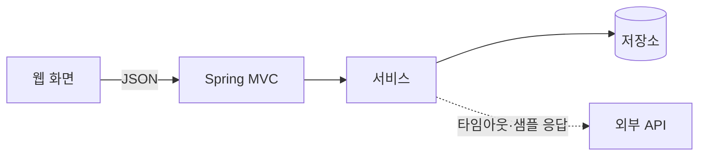

# 설계: <기능 이름>

## 개요
<요구사항을 어떻게 만족시키는지 한 문단>

## 아키텍처

## 구성 요소와 인터페이스
| 구성 요소 | 책임 | 인터페이스 |
|---|---|---|
| | | `METHOD /path` |

## 데이터 모델
| 필드 | 타입 | 제약 |
|---|---|---|

## 오류 처리
| 상황 | 응답 | 요구사항 |
|---|---|---|

## 테스트 전략
- HTTP 통합 테스트: 요구사항별 정상·검증 실패 경로
- 브라우저 E2E: 핵심 흐름 1개
- 배포 확인: 컨테이너 기동 후 smoke
